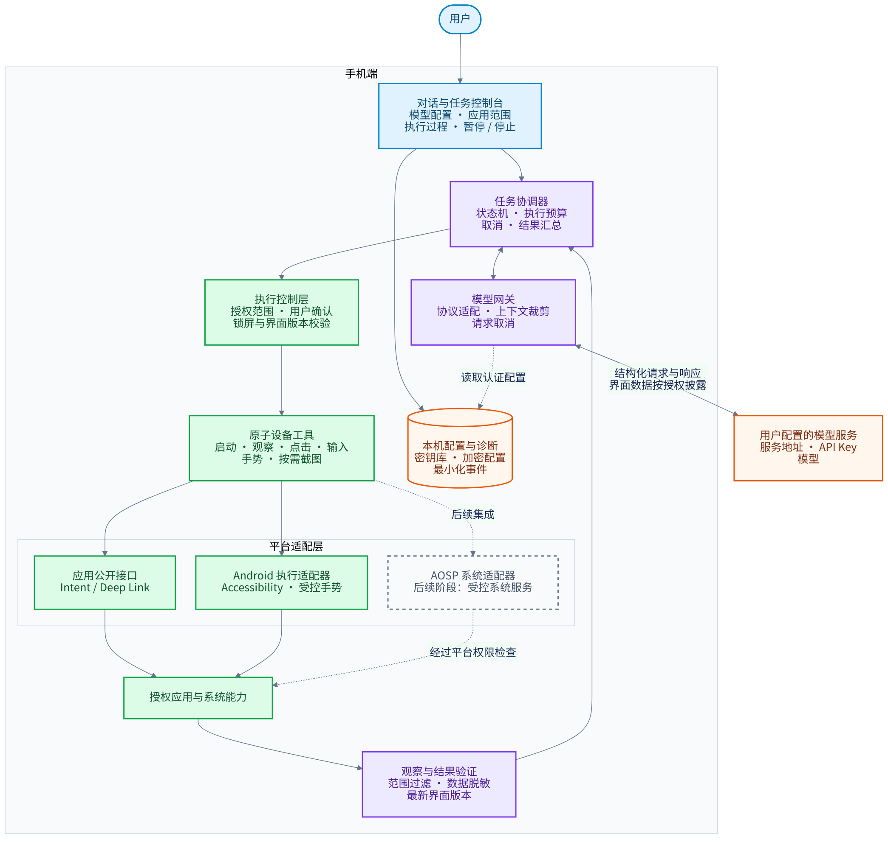

# Agent OS

一个以 Agent 为交互入口的 Android 定制系统项目：用户在手机内配置模型地址、密钥和模型，通过对话让 Agent 在授权范围内操作手机应用。

**当前阶段：Android 执行器原型。** 已实现任务运行时、原生控制台、加密配置与受控应用操作，可构建调试 APK；AOSP 集成和可刷写系统镜像尚未实现，真机兼容与性能仍待验证。详见[实现范围、构建与验证](IMPLEMENTATION.md)。

[原型安装与使用说明](docs/PROTOTYPE_GUIDE.md)涵盖模型配置、应用授权、逐步确认和接管操作。

## 演示视频

每类只列最新的可播放录像，链接直接指向视频文件；旧版本及失败记录保留在[录像档案](screenshots/demos/)。均为专用 API 35 模拟器的实际连续录屏，单个文件小于 100 MB。

| 类型 | 视频文件 | 展示内容与结果 | 录制源码 |
| --- | --- | --- | --- |
| 真实 APK 日常流程 | [计算器与 Notes · 53.2 秒](screenshots/demos/probes-40876724393-1/video/demo.mp4) | 计算 2+3、创建笔记、保存并重启读回；Agent 关闭与空闲两态，[4/4 通过](screenshots/demos/probes-40876724393-1/manifest.json) | [`aee3d4e01`](https://github.com/ecojust/Agent-OS/commit/aee3d4e015ab864fada973b8bb8c67bb0c90227e) |
| 计算器页面观察 | [播放视频 · 33.2 秒](screenshots/demos/probes-40876724624-1/video/demo.mp4) | 普通页面、菜单、历史、设置和单位换算的生产观察与允许/拒绝判断，[5/5 通过](screenshots/demos/probes-40876724624-1/manifest.json) | [`aee3d4e01`](https://github.com/ecojust/Agent-OS/commit/aee3d4e015ab864fada973b8bb8c67bb0c90227e) |
| 普通任务与用户接管 | [播放视频 · 36.9 秒](screenshots/demos/41052543898-1/demo.mp4) | 输入、保存、导航，以及确认、暂停、恢复、停止；[13 个阶段通过](screenshots/demos/41052543898-1/manifest.json) | [`054be1f34`](https://github.com/ecojust/Agent-OS/commit/054be1f34f552771fb874eee6609f5d40f3466e3) |

前两类由测试程序操作官方原版 APK；普通任务演示使用合成 Fixture 应用与本地测试模型。各自的录制范围与测试证据见[操作演示说明](docs/validation/operation-demo.md)。

本次30分钟分段压力源码的普通演示已核验并更新上表；此前 ready 阶段失败的[原始记录](screenshots/demos/40907100293-1/manifest.json)继续保留。普通流程录像不代替 Settings 来源拒绝、旋转或完整 API 矩阵验收。

## 项目范围

任务预算区支持[数值偏好导入导出](docs/PROTOTYPE_GUIDE.md#导入与导出数值偏好)：通过系统文件选择器迁移每次回复 Token 上限及三项任务预算，导入先预览、只填入草稿，再由用户保存或开始任务。文件不含模型连接、密钥、应用授权或任务内容；具体验证范围见[模块记录](docs/validation/numeric-preferences.md)。

持续验证包括核心协议测试、Android 11—17 八个 API 环境的真实交互，以及逐次归档的[测试截图](screenshots/README.md)。具体提交的结果见[验证记录](IMPLEMENTATION.md#验证记录)；失败和未运行的项目保留在报告中。测试使用独立合成应用，第三方应用与厂商真机尚未验收。

已增加[第三方应用开发探针](docs/validation/third-party-smoke.md)：固定官方安装包，在 Agent 关闭与绑定空闲两态检查真实应用流程，并独立保留截图和失败证据。该探针不替代常用应用与真机的完整验收。

首版面向**手机不插 SIM 卡、通过 Wi-Fi 使用，已解锁且操作过程可见**的场景；不启用 eSIM，不将蜂窝通话、短信、移动数据或专门来电中断流程纳入首版范围。先以 Android 执行器验证跨应用任务，再将成熟的任务服务、执行能力和交互入口集成到 AOSP 系统。

**兼容性优先：尽量覆盖近五年发布的 Android 手机。** 执行器以 Android 11 及以上为目标，保留用户现有系统；新功能按设备能力启用。系统镜像单独进行机型适配，AOSP 基线根据硬件支持与维护条件确定。目前尚无已验证设备，详见[兼容性策略与测试矩阵](docs/COMPATIBILITY.md)。

**第三方应用日常可用和性能是发布门槛。** 系统保留标准 Android 应用底座，应用正常运行不经过 Agent 或模型代理。采用固定常用应用样本验证安装、升级与核心流程，并对比 Agent 关闭、空闲和执行时的启动、卡顿及资源开销。详见[应用兼容性验收](docs/APP_COMPATIBILITY.md)与[性能架构及预算](docs/PERFORMANCE.md)；这些指标目前均为规划目标。

[统一设计规则](docs/DESIGN_RULES.md)规定用户接管、界面失效、授权、工具协议、模型与数据、资料隔离、交互、更新及维护。无卡模式仍保留锁屏、撤权和目标变化时的通用执行检查。

发布前可使用[离线APK升级预检](docs/validation/apk-upgrade-preflight.md)，对两份本地安装包核对可信证书、项目包名和递增版本号。它不执行安装，配置迁移和真机升级仍需另外验证。

<!-- development-progress:start -->
## Development Progress

进度按下列固定工程检查点计数，不代表总工作量或手机兼容率。未验收的机型、应用及刷机镜像保持未验证。

**本次更新：** 完成30分钟分段压力：八档240段/480任务全部通过、3120采样及308载荷独立核验；同源36.934秒演示已归档，下一项活跃等价对照，真机预算未验收

**记录时间：** 2026-10-30T12:46:52Z

[最近测试截图与清单](screenshots/41052540296-1/) · [对应测试运行](https://github.com/ecojust/Agent-OS/actions/runs/41052540296)。通过、失败及未截图原因见清单。

**整体操作演示：** [播放视频](screenshots/demos/41052543898-1/demo.mp4) · [录制与验证清单](screenshots/demos/41052543898-1/manifest.json) · [测试运行](https://github.com/ecojust/Agent-OS/actions/runs/41052543898)。
录制版本：[`054be1f34`](https://github.com/ecojust/Agent-OS/commit/054be1f34f552771fb874eee6609f5d40f3466e3)。视频来自专用 API 35 模拟器，模型响应由本地测试服务提供；不是实际大模型或真机兼容验收。单个视频小于 100 MB。

最近更新时间记录该条状态或进度说明的修改时间，采用 UTC；测试发生时间以对应证据为准。

| 检查点 | 状态 | 详细进度 | 最近更新时间（UTC） |
| --- | --- | --- | --- |
| 设计规则与兼容性基线 | 已完成 | 已固定授权、确认、取消、隐私、兼容与发布规则，区分当前能力和后续目标；各模块按对应规则验收。 [依据](docs/DESIGN_RULES.md) | 2026-10-29 14:56:24 |
| 可重复 APK 构建 | 已完成 | 已接通 Java 17、固定 Gradle 依赖、调试 APK 构建、lint 与 CI 产物归档；正式签名交付另列验收。 [依据](.github/workflows/android.yml) | 2026-10-29 14:56:24 |
| 有界任务与工具协议 | 已完成 | 已实现单任务、执行代次、预算、暂停/停止、重复调用去重及未知写结果处理，并有协议与设备回归。 [依据](core/src/test/java/dev/agentos/core) | 2026-10-29 14:56:24 |
| 模型网关与连接探测 | 已完成 | 已实现模型地址/密钥配置、有界 HTTP 请求、取消与连接/工具探测；合成请求通过不代替真实模型任务验收。 [依据](core/src/main/java/dev/agentos/core/ModelProbe.java) | 2026-10-29 14:56:24 |
| 原生控制台与加密配置 | 已完成 | 已实现原生任务与设置界面、Keystore 加密配置、配置失效与安全窗口；旋转等生命周期边界在 API 矩阵继续验证。 [依据](app/src/main/java/dev/agentos/app/SettingsStore.java) | 2026-10-29 14:56:24 |
| 基础结构化设备操作 | 已完成 | 已实现授权应用启动、最小范围观察、节点点击、输入、滚动、返回和主页；写入执行对应确认策略及最终条件校验，连续导航范围另列。 [依据](https://github.com/ecojust/Agent-OS/actions/runs/40342640357) | 2026-10-29 14:58:49 |
| 焦点窗口一致性与切换回归 | 已完成 | 当前结构化窗口合同已验证 18 用例×8档＝144/144；按实际焦点、控件身份与遮挡校验。旋转、多窗口和视觉手势不并入此完成结论。 [依据](docs/validation/structured-windows.md) | 2026-10-29 14:56:24 |
| 设备能力与兼容性诊断 | 已完成 | 已实现 API、ABI、内存、显示、WebView 与自身服务状态的只读诊断；明确区分设备条件与实际兼容验收。 [依据](screenshots/40362128378-1/manifest.json) | 2026-10-29 14:56:24 |
| 逐次测试截图与证据归档 | 已完成 | 已接通真实截图和视频的来源、摘要与结果归档，保留失败、受保护和未采集记录；README 已分类链接最新实际录像。 [依据](screenshots/README.md) | 2026-10-29 14:56:24 |
| Android 11–17 API 行为矩阵 | 进行中 | 三轮已核验2183/2184、2182/2184、2183/2184，共6548/6552；未满足不复现后完成的条件。导航72/72、SAF144/144，视觉12实际正例及12不支持路径通过。未完成：API30三轮均六次边界失配（17/18次右/下+2px）；第二轮API35点击前身份失效；后续生命周期扩展。下一步：分别定位平台几何差异与控件失效触发点，保留原精度和观察预算。 [依据](docs/validation/matrix-repeat-2026-10-30.md) | 2026-10-30 09:48:56 |
| 三态性能诊断与空闲交替配对 | 已完成 | 已完成当前诊断范围：710e三轮三态/停止汇总、084d空闲配对八档8/8、48对96窗及2016采样。后续054be分段压力亦已独立通过八档240段/480任务、3120采样，详情另表。活跃等价流程、目标进程、启动/完整帧、繁忙停止与真机预算继续单列，预算仍未验收。 [依据](docs/validation/performance-idle-pairs.md) | 2026-10-30 12:46:52 |
| 受控截图与视觉观察 | 进行中 | 已验证：内部验收构建在API34–37完成原生捕获、审阅和发送8/8；固定计算器页面专项20/20，最新API35录像5/5。未完成：普通APK截图入口仍关闭，旧超时根因及完整图像内存、真实模型披露待验收。下一步：明确支持页面和能力开放条件，补齐生产路径验收。 [依据](docs/VISUAL_PIPELINE.md) | 2026-10-29 14:56:24 |
| 绑定界面版本的坐标操作 | 进行中 | 已验证：只读坐标定位可解析绑定当前观察版本的节点候选。未完成：坐标点击/滑动仍关闭，图片到屏幕映射、捕获身份/时效及最终提交校验待完成。下一步：冻结最小手势合同，验证过期、遮挡、取消与未知结果不重试。 [依据](docs/VISUAL_PIPELINE.md) | 2026-10-29 14:56:24 |
| 普通操作连续执行与接管 | 进行中 | 已验证：054be源码API35普通流程13阶段、8次确认通过，36.9秒录像已核验并保留安全标志；仅启动/滚动/主页可选免确认。历史ready和旋转失败继续保留，普通视频不替代性能数值。未完成：普通写操作连续执行和实际模型接管尚未验收。下一步：冻结连续写范围，补端到端接管与启动可用性验证。 [依据](screenshots/demos/41052543898-1/manifest.json) | 2026-10-30 12:12:54 |
| 真实模型跨应用任务验收 | 待实现 | 已验证：本地合成HTTP模型到执行器的链路；现有录像未使用外部模型。未完成：真实模型自主完成受控跨应用目标尚无验收证据。下一步：冻结实际模型服务、版本、授权应用和可独立核对结果的任务，在模拟器实跑并保留失败。 [依据](docs/PRODUCT_PLAN.md) | 2026-10-29 14:56:24 |
| 冻结常用应用样本与日常使用验收 | 进行中 | 已验证：冻结2款官方APK，八档16次安装成功，流程24/32（计算器16/16、Notes8/16）；最新API35录像4/4。未完成：Notes另8项键盘隐藏确认失败、Agent执行态、第三方应用升级，以及建议至少50款的样本扩展。下一步：定位失败，完善冻结样本的三态流程。 [依据](screenshots/third-party-40834304846-1/manifest.json) | 2026-10-29 14:57:50 |
| 跨厂商近五年真机与资源档验证 | 待外部条件 | 已完成：定义跨厂商、芯片、上市年份及资源档的选样要求。阻塞：尚无参考手机或真机测试环境，暂无机型验收。下一步：确定可用设备清单，按固定任务验证权限、后台行为与资源表现。 [依据](docs/COMPATIBILITY.md) | 2026-10-29 14:56:24 |
| 参考机 AOSP 集成与平台兼容套件 | 待外部条件 | 已完成：定义系统集成、特权桥接与兼容验证目标。阻塞：参考机、可解锁性、内核和厂商驱动未确定，尚无可刷写镜像。下一步：确定机型和可维护源码基线，再完成构建、启动及平台兼容套件验证。 [依据](docs/PRODUCT_PLAN.md) | 2026-10-29 14:56:24 |
| 机型 OTA 与失败启动恢复 | 待外部条件 | 已完成：定义OTA、降级限制与失败启动恢复要求。阻塞：尚无参考机镜像和可验证恢复环境，未完成实际OTA/恢复。下一步：在机型确定后验证签名、升级、失败恢复及数据保留边界。 [依据](docs/DESIGN_RULES.md) | 2026-10-29 14:56:24 |
| 正式签名交付与维护验收 | 待外部条件 | 已验证：离线APK预检22项及临时开发同签名升级八档8/8。未完成：正式签名/轮换、格式迁移、执行中更新，以及设备/应用验收和维护范围。下一步：先固定发布清单与迁移合同，正式签名和设备条件到位后验收交付。 [依据](docs/validation/apk-upgrade-smoke.md) | 2026-10-29 14:56:24 |

依据：[进度源数据](docs/progress.json) · [实现与验证范围](IMPLEMENTATION.md) · [测试截图](screenshots/README.md) · [操作演示说明](docs/validation/operation-demo.md)。
<!-- development-progress:end -->

性能后续任务另见[30分钟压力、活跃对照、应用体验与真机预算清单](docs/PERFORMANCE.md#性能后续任务)，其中保留各项未完成进度和最近更新时间。

## System Architecture

[查看可缩放架构图](docs/diagrams/system-architecture.svg) · [架构与执行流程](docs/ARCHITECTURE.md) · [功能规划与验收标准](docs/PRODUCT_PLAN.md)

## Capabilities and Roadmap

| 模块 | 规划能力 |
| --- | --- |
| 对话入口 | 输入任务、查看步骤与本次操作回执、处理确认、暂停与停止 |
| 模型接入 | 在手机内配置服务地址、密钥和模型；分别测试工具调用与合成图片理解，结果独立显示，首版使用兼容 Chat Completions 的服务 |
| 应用操作 | 已实现授权应用启动、结构化观察、节点点击、输入、滚动与只读坐标定位；截图与坐标手势尚未开放 |
| 执行与验证 | 每次动作校验当前界面，操作后重新观察，区分操作已提交与目标已完成 |
| 兼容与适配 | 系统版本和设备能力探测、可选能力降级、低资源模式与明确的设备验证状态 |
| 应用日常使用 | 标准运行时与系统组件、安装更新和常用应用核心流程验证，与 Agent 自动操作结果分开统计 |
| 性能与资源 | 事件驱动、有界队列、按需图片、主线程预算和同机三状态性能对照 |
| 用户控制 | 应用授权、默认逐步确认、可选连续导航、暂停/停止及任务预算；点击、输入和返回仍需逐次确认 |
| 系统集成 | 后续接入系统服务、对话桌面和经过真机验证的 ARM64 设备支持 |

模型默认运行在用户配置的服务端；任务调度、设备操作和执行控制运行在手机端。任务执行只发送目标及允许披露的结构化界面信息，未启用截图；独立图像测试只上传自动生成的合成色块。模型最终说明标为待核对报告，不能代替实际结果验证。[构建检查与调试包](https://github.com/ecojust/Agent-OS/actions/workflows/android.yml)由 CI 提供；测试状态以具体提交的报告为准。

## Roadmap

1. **设计基线**：明确产品范围、模块边界、执行流程与验收标准。
2. **可安装原型**：验证手机端模型配置、可见执行、应用范围和取消机制。
3. **可靠执行**：完成真实跨应用任务、异常恢复，以及 Android 11—17 与不同厂商系统的分层验证；测量 Agent 对正常应用和系统性能的影响。
4. **系统集成**：选择参考手机，将执行能力接入 AOSP 并制作机型适配版本，完成平台兼容测试、固定应用样本和性能验收。
5. **设备扩展**：维护已验证机型列表，评估符合条件设备的通用系统镜像。

首个系统镜像以 ARM64 为目标。具体手机的启动、相机、Wi-Fi、蓝牙、指纹和功耗需要分别适配与测试；蜂窝能力未纳入首版验证，不承诺一个镜像兼容所有 ARM 手机。

## License

[MIT](LICENSE)。后续引入的系统组件、驱动及依赖分别遵守其原有许可证。
