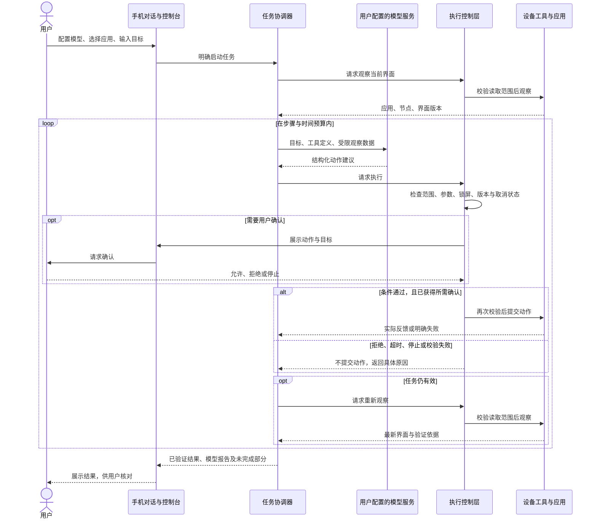
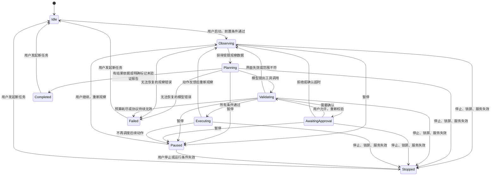
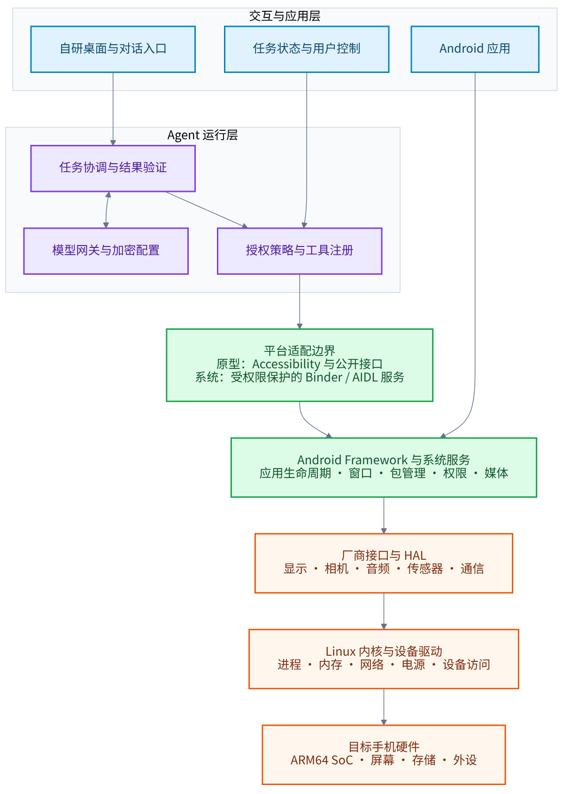
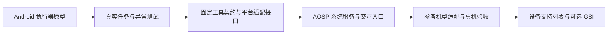

# Agent OS 系统架构

本设计描述目标架构与分阶段实现路径。当前仓库交付规划文档和设计图，尚未提供可安装执行器或可刷写系统。

## 1. 系统总览


[可缩放 SVG](diagrams/system-architecture.svg) · [Mermaid 源文件](diagrams/system-architecture.mmd)

### 架构边界

- 用户在手机内配置模型并发起任务，首版不依赖电脑端 Agent。
- 模型网关访问用户指定的模型服务；运行状态机、授权判断和设备操作保留在手机端。
- 模型给出结构化工具请求，执行层负责验证并调用设备能力，不执行模型生成的任意代码。
- 观察和写操作都经过执行控制层，读取数据同样受应用授权和披露范围约束。设备反馈回到观察与验证模块，驱动下一步；工具分发成功不能直接等同于用户目标完成。
- 原型适配器和 AOSP 适配器共用任务协议。AOSP 集成不改变应用授权、确认和用户停止的基本规则。

## 2. 分层设计

| 层 | 职责 | 输入 / 输出 | 不负责 |
| --- | --- | --- | --- |
| 交互层 | 对话、模型配置、应用选择、过程展示与用户确认 | 用户目标、明确授权、任务状态 | 直接执行任意模型输出 |
| 任务协调层 | 单任务状态机、步骤预算、暂停取消、结果汇总 | 目标、观察结果、工具请求 | 用自然语言替代权限校验 |
| 模型网关 | 协议转换、上下文裁剪、请求取消、错误归一化 | 结构化消息与模型响应 | 保存明文密钥或默认记录截图 |
| 执行控制层 | 应用范围、界面版本、锁屏状态、确认与参数校验 | 已校验动作或明确拒绝原因 | 授予模型超出用户选择的权限 |
| 设备工具层 | 应用发现、启动、节点操作、手势和截图 | 原子工具请求、实际执行反馈 | 将动作接受当作最终目标成功 |
| 平台适配层 | 封装应用接口、Accessibility 与后续系统服务 | 稳定工具语义、平台调用 | 隐藏不可用能力或硬件差异 |
| 存储与诊断层 | 密钥保护、加密配置、最小化事件记录 | 配置与脱敏事件 | 默认持久化聊天、界面文字和截图 |

## 3. 一次任务的执行流程



用户停止、锁屏、服务断开和预算耗尽均能中断以上流程。停止信号直接进入协调器和执行层，不等待模型同意或模型请求自然返回。

## 4. 任务状态机



`Completed` 只表示执行流程正常结束，不等于业务目标已经验证成功；结果另行记录目标验证状态，未验证内容必须明确标为模型报告。

暂停不保证撤回已经提交给系统的动作。恢复后重新观察并丢弃旧动作计划与旧确认；停止后使旧任务标识失效，迟到的网络响应和回调不能继续执行。

## 5. 工具协议和一致性

### 请求约束

- 每个调用带有任务标识、调用标识、工具名和经过 schema 校验的参数。
- 界面操作绑定 `expectedRevision`；节点 ID 不跨观察版本复用。
- 同一任务的设备写操作串行执行，模型一次返回多项操作也不能绕过逐项验证。
- 应用启动、点击、输入和导航后必须重新观察，才能继续依赖界面的动作。
- 拒绝、超时和取消返回可区分的错误，模型不得改用坐标手势绕过用户拒绝。

### 结果约束

```json
{
  "taskId": "task-example",
  "callId": "call-example",
  "ok": true,
  "dispatchAccepted": true,
  "verification": "pending",
  "data": {
    "packageName": "dev.example.notes",
    "revision": "screen-version"
  }
}
```

上例只表示操作已被接受，仍需后续观察。目标验证可以使用前台应用、页面标识、目标控件状态或确定性应用接口返回值。模型自己的总结以“模型报告”展示，不伪装成设备验证结果。

对于结果不确定的写操作，调用标识用于抑制重复提交。不能证明幂等的动作不自动重发。任务预算包含模型轮次、工具数量、总时长和重复失败次数。

## 6. 数据与权限

| 数据 | 默认位置 / 去向 | 处理规则 |
| --- | --- | --- |
| 模型密钥 | 手机加密配置，密钥受系统密钥库保护 | 仅用于所配置服务认证，不进入日志和模型上下文 |
| 任务文本 | 本次任务内存、所配置模型服务 | 默认不保存历史 |
| 界面结构 | 本次任务内存、所配置模型服务 | 限制应用、节点数和文本长度；密码值不披露 |
| 截图 | 确认后临时发送至所配置模型服务 | 不默认落盘，安全窗口和密码页面拒绝 |
| 授权范围与设置 | 手机配置 | 不允许模型修改授权范围或关闭确认机制 |
| 诊断事件 | 有界本地记录 | 使用动作类别、状态和错误码，避免原始内容 |

用户允许操作某个应用，不等于允许模型执行该应用内的全部高影响行为。执行策略必须由手机端约束；模型提示词只能辅助判断，不能承担唯一授权控制。

## 7. 从原型到系统

以下为目标系统的逻辑分层图；具体服务调用关系和进程边界在参考机型及系统版本确定后细化。



[可缩放 SVG](diagrams/os-layers.svg) · [Mermaid 源文件](diagrams/os-layers.mmd)



### 原型阶段

普通安装包通过用户开启的 Accessibility 服务执行可见操作；公开应用接口按需接入。主要验证 Agent 任务闭环、授权范围、取消、界面版本和结果反馈。该阶段不修改内核，也不提供刷机包。

### AOSP 集成阶段

保留模型网关、任务协议和策略，将设备适配能力接入受控系统服务。系统端需设计调用者身份校验、签名权限、SELinux 规则、用户与工作资料隔离、服务生命周期和升级兼容。

具体采用特权应用还是独立系统服务，按能力需求评估；不预设整个 Agent 以高权限身份运行。模型通信与密钥管理尽量保持在较低权限组件中。

### 硬件适配阶段

Agent 核心不依赖具体芯片，但完整系统需要匹配设备内核、启动链和厂商驱动。首版选择一款资料完整的 ARM64 手机，验证启动、显示、触控、网络、通话、相机、指纹、功耗与恢复流程后，再扩展机型。

GSI 复用兼容设备的厂商实现，不能替代所有机型适配。需要逐一检查解锁条件、Treble、ABI、系统与厂商接口版本及原厂恢复路径。

## 8. 验证策略

| 层级 | 必测内容 | 结果说明 |
| --- | --- | --- |
| 核心协议测试 | 模型响应、工具参数、取消、预算、错误和重复调用 | 可以使用本地模型协议测试服务验证，不代表真实模型能力 |
| Android 模拟器 | 界面操作、状态机、授权范围、配置加密与服务生命周期 | 使用独立测试应用观察真实状态变化 |
| 真实模型联调 | 多轮计划、工具调用、上下文裁剪、图片能力 | 按具体模型记录支持情况，不默认兼容所有接口 |
| 真机执行测试 | 实际应用、自绘界面、权限页面、锁屏与厂商限制 | 分机型、系统版本和应用版本记录结果 |
| 系统镜像测试 | 启动与硬件、权限隔离、升级与恢复 | 必须在目标设备完成，不能用模拟器替代 |

当前参考设备、模型验证名单和 AOSP 版本尚未确定，本次文档不会将规划能力标记为已完成。

## 9. 官方参考

- [AOSP 架构概览](https://source.android.com/docs/core/architecture)
- [Android AccessibilityService](https://developer.android.com/reference/android/accessibilityservice/AccessibilityService)
- [Android 后台启动 Activity 的限制](https://developer.android.com/guide/components/activities/background-starts)
- [GSI 设备条件与兼容性检查](https://developer.android.com/topic/generic-system-image)
- [AOSP GSI 构建与设备要求](https://source.android.com/docs/core/tests/vts/gsi)
