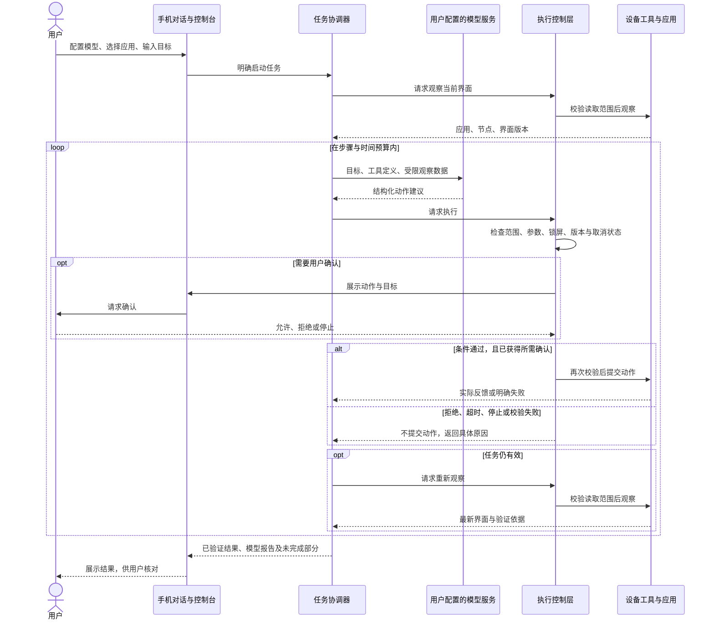
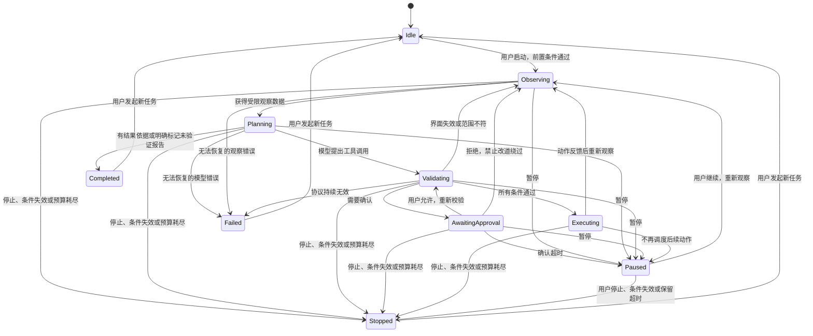
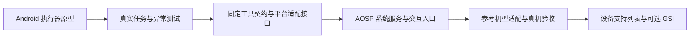

# Agent OS 系统架构

本设计描述目标架构与分阶段实现路径。当前仓库已提供 Android 执行器原型代码、规划文档和设计图；当前能力与验证记录见[实现状态](../IMPLEMENTATION.md)。可刷写系统尚未实现。

## 1. 系统总览


[可缩放 SVG](diagrams/system-architecture.svg) · [Mermaid 源文件](diagrams/system-architecture.mmd)

### 架构边界

- 用户在手机内配置模型并发起任务，首版不依赖电脑端 Agent。
- 默认无实体 SIM、无启用 eSIM，通过 Wi-Fi 使用；蜂窝业务与专门来电中断流程不纳入首版。通用锁屏、撤权、用户接管和界面失效检查仍适用，不新增完整中断管理子系统。
- 模型网关访问用户指定的模型服务；运行状态机、授权判断和设备操作保留在手机端。
- 模型给出结构化工具请求，执行层负责验证并调用设备能力，不执行模型生成的任意代码。
- 观察和写操作都经过执行控制层，读取数据同样受应用授权和披露范围约束。设备反馈回到观察与验证模块，驱动下一步；工具分发成功不能直接等同于用户目标完成。
- 原型适配器和 AOSP 适配器共用任务协议。AOSP 集成不改变应用授权、确认和用户停止的基本规则。
- 兼容性优先：核心运行目标为 Android 11 及以上，通过版本适配与能力探测覆盖近五年手机；AOSP 系统基线按具体机型另行确定。详见[兼容性策略与测试矩阵](COMPATIBILITY.md)。
- 第三方应用通过标准 Android 运行时和框架直接运行，不经过 Agent 或模型代理。Agent 故障、断网或关闭不阻断应用的正常生命周期。
- 性能与资源调度作为架构约束：主线程不等待网络与模型，任务队列、观察、图片和日志有界，停止通道优先于普通执行。

具体行为以[统一设计规则](DESIGN_RULES.md)为准，包含内部协议版本、确认有效期、网络与任务预算、配置迁移、更新和维护责任。

## 2. 分层设计

| 层 | 职责 | 输入 / 输出 | 不负责 |
| --- | --- | --- | --- |
| 交互层 | 对话、模型配置、应用选择、过程展示与用户确认 | 用户目标、明确授权、任务状态 | 直接执行任意模型输出 |
| 任务协调层 | 单任务状态机、步骤预算、暂停取消、结果汇总 | 目标、观察结果、工具请求 | 用自然语言替代权限校验 |
| 性能与资源调度层 | 工作优先级、有界队列、事件合并、资源预算与及时释放 | 待处理工作、取消信号、资源状态 | 用旧界面缓存执行操作或把任务阻塞转移到系统关键线程 |
| 模型网关 | 协议转换、上下文裁剪、请求取消、错误归一化 | 结构化消息与模型响应 | 保存明文密钥或默认记录截图 |
| 执行控制层 | 应用范围、界面版本、锁屏状态、确认与参数校验 | 已校验动作或明确拒绝原因 | 授予模型超出用户选择的权限 |
| 兼容与能力层 | 运行版本检查、能力探测、工具可用性与版本实现选择 | 设备条件、受限能力清单、可用适配器 | 以降级为理由绕过授权或泄露敏感信息 |
| 设备工具层 | 应用发现、启动、节点操作、手势和截图 | 原子工具请求、实际执行反馈 | 将动作接受当作最终目标成功 |
| 平台适配层 | 封装应用接口、Accessibility 与后续系统服务 | 稳定工具语义、平台调用 | 隐藏不可用能力或硬件差异 |
| 存储与诊断层 | 密钥保护、加密配置、最小化事件记录 | 配置与脱敏事件 | 默认持久化聊天、界面文字和截图 |

兼容与能力层在模型调用前生成当前可用工具清单，在执行前重新检查动态条件；模型不能启用设备不具备或用户未授权的能力。新版 API 的引用和类加载隔离在对应平台实现内，低版本不会为了启动应用而加载这些实现。能力缺失时返回明确限制，能在原授权范围内完成的文本与节点任务仍可执行。

### 标准应用底座

系统保留 ART、核心类库、Bionic/JNI、包管理、权限与沙箱、任务栈、可维护的 WebView、图形与媒体组件。Agent 增加受控交互能力，不替换普通应用的运行环境，也不要求所有应用经过统一 Hook。应用签名、设备能力和认证状态均需真实匹配。

安装成功、日常可用和 Agent 可操作是独立结果。登录、推送、DRM 或服务端风控等外部依赖须实际验证；标准 Android 平台测试不能替代授权和服务端认可。详见[第三方应用兼容性与验收](APP_COMPATIBILITY.md)。

### 性能与故障隔离

对话界面、任务计算和平台执行逻辑分别管理；网络、图片编码与解析放在工作线程，平台线程只执行符合线程约束的有界操作。是否单独进程以故障隔离和实测内存成本决定，不为每个模块创建常驻进程。

设备写操作串行，观察事件合并且只保留最新的必要工作，旧任务及时取消。暂停与停止不等待模型返回；取消状态在动作分发前再次检查。模型网关失效不影响用户手动使用其他应用。

AOSP 特权桥接保持小而受控的接口，不在 `system_server` 或输入、绘制、包管理的同步路径执行模型、网络及图像工作。具体队列、图片和性能预算以及同机三状态对照见[性能架构与验收预算](PERFORMANCE.md)。

## 3. 一次任务的执行流程



用户停止、锁屏、服务断开和预算耗尽均能中断以上流程。停止信号直接进入协调器和执行层，不等待模型同意或模型请求自然返回。

## 4. 任务状态机



`Completed` 只表示执行流程正常结束，不等于业务目标已经验证成功；结果另行记录目标验证状态，未验证内容必须明确标为模型报告。

暂停不保证撤回已经提交给系统的动作。暂停时使执行代次失效并取消请求；恢复保留同一任务及累计预算，递增代次，重新观察并丢弃旧动作计划与旧确认。停止后使旧任务标识失效，迟到的网络响应和回调不能继续执行。

图中的“条件失效”包括锁屏、熄屏、执行服务失效、关键撤权和资料切换。无法确认的前台变化或遮挡进入暂停；旋转、键盘和相关目标变化先使观察失效，再决定重新观察或暂停。首版不为蜂窝来电设计专门状态。

## 5. 工具协议和一致性

### 请求约束

- 每个调用带有内部协议版本 `1`、任务标识、调用标识、执行代次、资料身份、工具名和经过 schema 校验的参数；可信本机上下文决定代次和资料，模型不能自行指定操作其他资料。
- 界面操作绑定 `expectedRevision`；节点 ID 不跨观察版本复用。
- 首次或刷新当前状态的观察不需要旧版本，通过会话、代次、资料和授权校验后生成新版本；随后依赖该观察的动作必须匹配它。
- 同一任务的设备写操作串行执行，模型一次返回多项操作也不能绕过逐项验证。
- 应用启动、点击、输入和导航后必须重新观察，才能继续依赖界面的动作。
- 拒绝、超时和取消返回可区分的错误，模型不得改用坐标手势绕过用户拒绝。

### 结果约束

```json
{
  "protocolVersion": 1,
  "taskId": "task-example",
  "callId": "call-example",
  "executionEpoch": 1,
  "profileId": "current-personal",
  "ok": true,
  "dispatchAccepted": true,
  "verification": "pending",
  "data": {
    "packageName": "dev.example.notes",
    "revision": "screen-version"
  }
}
```

上例只表示操作已被接受，仍需后续观察。目标验证可以使用前台应用、页面标识、目标控件状态或确定性应用接口返回值。模型自己的总结以“模型报告”展示，不伪装成设备验证结果。

对于结果不确定的写操作，调用标识用于抑制重复提交。同 ID 同请求返回已有状态，同 ID 不同参数拒绝执行；不能证明未执行的写操作不自动重发。任务预算包含模型轮次、工具数量、活动时长和重复失败次数，确认和暂停另有等待时限。版本协商、错误码与默认值见[设计规则 R3—R5](DESIGN_RULES.md#r3-授权与确认绑定)。

## 6. 数据与权限

| 数据 | 默认位置 / 去向 | 处理规则 |
| --- | --- | --- |
| 模型密钥 | 手机加密配置，密钥受系统密钥库保护 | 仅用于所配置服务认证，不进入日志和模型上下文 |
| 任务文本 | 本次任务内存、所配置模型服务 | 默认不保存历史 |
| 界面结构 | 本次任务内存、所配置模型服务 | 限制应用、节点数和文本长度；密码值不披露 |
| 截图 | 确认后临时发送至所配置模型服务 | 不默认落盘，安全窗口和密码页面拒绝 |
| 授权范围与设置 | 手机配置 | 不允许模型修改授权范围或关闭确认机制 |
| 诊断事件 | 默认仅内存，最多 200 条 | 使用动作类别、状态和错误码，进程退出不恢复；用户可预览脱敏内容并导出 |

用户允许操作某个应用，不等于允许模型执行该应用内的全部高影响行为。执行策略必须由手机端约束；模型提示词只能辅助判断，不能承担唯一授权控制。

首版仅操作当前个人资料，授权、缓存、密钥和诊断按资料隔离。默认无任务历史持久化；密钥不进入普通导出或系统云备份。配置迁移失败保留原数据，密钥失效要求重新配置，不降级为明文；详见设计规则 R6、R7 和 R9。

## 7. 从原型到系统

以下为目标系统的逻辑分层图；具体服务调用关系和进程边界在参考机型及系统版本确定后细化。


[可缩放 SVG](diagrams/os-layers.svg) · [Mermaid 源文件](diagrams/os-layers.mmd)



### 原型阶段

普通安装包通过用户开启的 Accessibility 服务执行可见操作；公开应用接口按需接入。主要验证 Agent 任务闭环、授权范围、取消、界面版本和结果反馈。该阶段不修改内核，也不提供刷机包。

广泛覆盖现有手机以 APK 模式为主，不要求用户升级到同一 Android 版本。当前计划覆盖 Android 11—17；系统版本、厂商行为、应用版本和模型能力分别记录验证状态。截图等可选功能按能力启用，基础执行不要求本地模型、专用 AI 芯片或 64 位原生依赖。

### AOSP 集成阶段

保留模型网关、任务协议和策略，将设备适配能力接入受控系统服务。系统端需设计调用者身份校验、签名权限、SELinux 规则、用户与工作资料隔离、服务生命周期和升级兼容。

具体采用特权应用还是独立系统服务，按能力需求评估；不预设整个 Agent 以高权限身份运行。模型通信与密钥管理尽量保持在较低权限组件中。

### 硬件适配阶段

Agent 核心不依赖具体芯片，但完整系统需要匹配设备内核、启动链和厂商驱动。首版选择一款资料完整的 ARM64 手机，验证启动、显示、触控、Wi-Fi、蓝牙、相机、指纹、功耗与恢复流程后，再扩展机型。蜂窝通话、短信与移动数据不纳入首版验收，保留标准平台组件且不宣称这些能力已通过验证。

GSI 复用兼容设备的厂商实现，不能替代所有机型适配。需要逐一检查解锁条件、Treble、ABI、系统与厂商接口版本及原厂恢复路径。

AOSP 基线选择兼顾参考机型的可维护驱动与稳定源码，暂不锁定 Android 17，也不为覆盖旧手机统一降到 Android 11。保持可安装执行器与系统镜像两条交付路径，核心协议复用，支持声明分别验证。

## 8. 验证策略

| 层级 | 必测内容 | 结果说明 |
| --- | --- | --- |
| 核心协议测试 | 模型响应、工具参数、取消、预算、错误和重复调用 | 可以使用本地模型协议测试服务验证，不代表真实模型能力 |
| Android 模拟器 | 界面操作、状态机、授权范围、配置加密与服务生命周期 | 使用独立测试应用观察真实状态变化 |
| 真实模型联调 | 多轮计划、工具调用、上下文裁剪、图片能力 | 按具体模型记录支持情况，不默认兼容所有接口 |
| 真机执行测试 | 实际应用、自绘界面、权限页面、锁屏与厂商限制 | 分机型、系统版本和应用版本记录结果 |
| 系统镜像测试 | 启动与硬件、权限隔离、升级与恢复 | 必须在目标设备完成，不能用模拟器替代 |
| 应用日常使用测试 | 固定应用样本的安装更新、登录、通知、媒体与其他核心流程 | 和 Agent 可操作性分开统计，特殊依赖与未验证项保留在完整结果中 |
| 性能与资源测试 | 同机关闭/空闲/运行三态、系统镜像基线对照、启动/帧时间/资源和能耗 | 预算与测量值分开，网络模型等待与本地调度开销分开 |

当前参考设备、真实模型验证名单和 AOSP 版本尚未确定。已实现模块的自动化结果与当前限制单独记录，不将规划能力标记为已完成。

版本、厂商、内存、显示与生命周期等详细测试维度，以及“已验证 / 有限支持 / 未验证 / 不支持”的记录规则，统一维护在[兼容性策略](COMPATIBILITY.md)。

## 9. 官方参考

- [AOSP 架构概览](https://source.android.com/docs/core/architecture)
- [Android AccessibilityService](https://developer.android.com/reference/android/accessibilityservice/AccessibilityService)
- [Android 后台启动 Activity 的限制](https://developer.android.com/guide/components/activities/background-starts)
- [GSI 设备条件与兼容性检查](https://developer.android.com/topic/generic-system-image)
- [AOSP GSI 构建与设备要求](https://source.android.com/docs/core/tests/vts/gsi)
