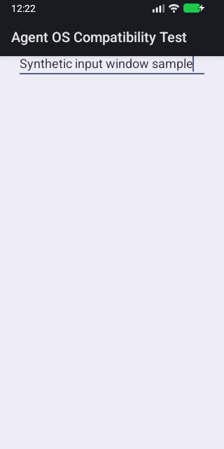
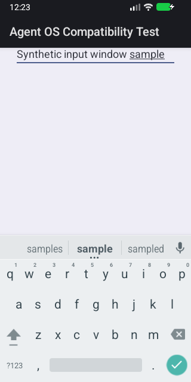

# API37 硬键盘显示设置对照

本轮承接[后置输入法观测](window-infos-ime-state.md)：AVD文件报告 `hw.keyboard=no`，实际输入法收到 `qwerty/v/v`，硬键盘下显示软键盘缓存为FALSE、输入视图未显示。冻结一次同模拟器的A→B对照，核查该设置改变后原始窗口正对照是否出现，同时归档运行时输入设备与AVD原文件。

## 冻结执行合同

仅使用专用API37合成模拟器，用户0、shell UID2000。预先只读保存AVD配置文件，要求唯一 `hw.keyboard=no`；运行一次有界 `dumpsys input`（服务5秒、设备8秒、宿主12秒、262144字节），再用 `settings --user 0 list secure` 保存原设置的存在性和值。

只支持 `show_ime_with_hard_keyboard` 原本缺失或为字符串 `0`。原值为1或其他内容时保留未完成原因，不改写。list必须完整、非空、键唯一，并含有效的 `default_input_method` 上下文；与A选择的组件及后续读回核对。空输出即使exit0也不构成缺失证据，不能将 `settings get` 的字符串 `null` 直接视为键不存在。配置文件与输入设备、IME Configuration来自不同层；未打印的字段保留未知。

| 组别 | 设置与执行 | 必须保留的结果 |
| --- | --- | --- |
| A baseline | 原设置；完整执行一次既有raw流程 | 原始正对照通过或失败、完整回调、一次show回执、后置IME状态、PNG及清理结果 |
| B enabled | 临时设置为1并读回核对；相同APK/jar执行一次既有raw流程 | 同样保留全部原件；正对照、IME缓存TRUE、输入视图显示分别核对 |
| 恢复 | 原缺失则delete，原0则put0；各执行一次，再读回 | 同时核对原值和存在性；失败、取消或未知不能写成恢复成功 |

A只在完整取得原始结果、页面回执、IME状态与截图、清理成功，且IME缓存FALSE时才进入B。A允许的原始失败仅为 `RAW_POSITIVE_CALLBACK_NOT_OBSERVED`；失败继续进入原始组别分母。两组复用未修改的 `window_infos_raw.py`，各一次构造/注册/注销、一次显示请求、12秒回调区间与四项过滤均保持。

A确认安装了本次合成包后，仅卸载该 `dev.agentos.compat` 并核对不存在，再运行B的原全新安装检查。两组APK及jar字节相同，每组独立核对安装身份，UID可能变化。固定顺序、输入法暖状态和重装仍是混杂因素，因此这不是随机交替实验，也不单凭一对结果证明原Notes失败的因果。

写设置前先持久化原值与写入意图，避免命令超时但已生效时漏恢复。正常路径在finally恢复；工作流finalize只在尚未尝试恢复时作一次兜底。已尝试过的恢复不重复写。取消状态保留，恢复自身使用独立的有限命令期限；若模拟器已销毁，保留恢复未观测状态。恢复承诺只包括逻辑值及存在性，不包括SettingsProvider标签、默认值或内部元数据。

## 证据与独立校验

顶层保留设置读写原命令、持久化journal、输入设备dump与派生结果、AVD原文件及原APK；每组保留既有raw完整目录，包括jar、原始回调、fixture、IME状态、命令、截图和报告。顶层最多16命令/2MiB输出，每组仍使用原40命令/2MiB上限，整树有效命令目录上限80、输出6MiB。

输入设备解析器只解释固定源码的EventHub与InputReader段，按实际ID关联设备，保留名称、来源、KeyboardType、外部/虚拟标志和启用状态。Reader/原生manager没有打印的keyboard、hardKeyboardHidden明确为 `not_printed`；不会从某个键盘能力反推出IME最终配置。虚拟设备ID与 `IsVirtualDevice` 字段也分别保留。格式、数量、关联或边界不符合时状态未知，仍可完成计划的两组采集，但顶层不标通过。

新归档单独使用 `window-infos-keyboard`，校验源workflow/job模式、原始来源、嵌套文件白名单、大小/摘要和每组原合同。原schema1/2归档保持原来源，禁止补写新观测。顶层对照结果与两组raw结果分别统计；即使B成功且恢复确认，A失败仍计为一组失败。

## 实施进度

宿主协调、输入设备解析、嵌套归档与专用CI接线已完成，[196项本地验证](diagnostics/window-infos-keyboard-2026-11-01/local-validation.json)通过：既有raw宿主/归档/构建74、IME33、新input解析27、新协调23及新归档39。归档其中10项使用真实协调校验器联合验证，覆盖A失败/B成功、两种原值恢复、恢复失败、输入未知及原件篡改；[具体回执](diagnostics/window-infos-keyboard-2026-11-01/archive-validation.json)保持合成数据的范围。actionlint与进度一致性检查通过，Android及产品代码未改。[最后独立复核](diagnostics/window-infos-keyboard-2026-11-01/input-parser-final-review.json)补齐负内建键盘ID不能别名为设备0的边界；无效关联保持未知，正常内建及虚拟设备保留。

实际执行源码冻结为 `aee08f1976f29ebcb62ddd15d37ae30663445228`，包含协调模块及内建键盘别名边界修正。2026-11-01，[API37对照41305950037](https://github.com/ecojust/Agent-OS/actions/runs/41305950037)和[同源API35整体录像41305953660](https://github.com/ecojust/Agent-OS/actions/runs/41305953660)各执行一次。专项通过，普通录像失败；具体结果及限制如下。原Notes32项未重跑。

## 实际结果：设置对照通过，原设置组仍失败

[不可变归档](../../screenshots/window-infos-keyboard-41305950037-1/manifest.json)来自归档运行41306264093、提交 `73fa7067db671a2d66c52db32bae81bf021eff63`。顶层对照 **1/1通过**，两组raw分别为 **1通过、1失败、0未验证**，A的 `RAW_POSITIVE_CALLBACK_NOT_OBSERVED` 原样保留。

同一Android17/API37、x86_64模拟器，实际指纹为 `Android/sdk_phone64_x86_64/emu64x:17/CE2A.260420.051.A3/16571990:userdebug/test-keys`。两组输入法均为 `com.android.inputmethod.latin/.LatinIME`、UID10112、display0；合成包重装后UID从10156变为10157，分别核对，未将UID变化隐藏。

| 实际观测 | A：原设置0 | B：临时设置1 |
| --- | --- | --- |
| raw回调 / 同Binder候选记录 | 66 / 27 | 53 / 22 |
| 触摸区域为空 | 27/27 | 21/22 |
| NOT_VISIBLE / 空frame / CLONE | 5 / 2 / 0 | 4 / 1 / 0 |
| 满足原四项条件的回调 | 0，失败 | 1，通过本专项12秒窗口 |
| IME Configuration | qwerty/v/v（2/1/1） | 相同，未改变硬键盘配置 |
| 显示设置缓存 / 输入视图显示 | FALSE / false | TRUE / true |
| 后置IME Insets | top616，VISIBLE，空region | top370，REGION，矩形(0,370)–(320,616) |
| 后置截图 | 无软键盘 | 软键盘可见 |

两组均一次构造/注册/注销、一次show请求、12秒原始观察；没有丢弃、截断或区间外回调。A的27条与B的22条是各自同一Binder候选的多次记录，不是不同窗口的数量。IME原件分别48,469字节/25ms和54,488字节/26ms，均完整记录15字段。

| A后置画面 | B后置画面 |
| --- | --- |
|  |  |

两张真实截图均320×640，拍摄在各自raw冻结及IME dump之后。它们显示各自较晚的页面，不能替代某次回调的像素或Binder证明。

### 关键剩余问题：有效区域迟到，尚未满足原5秒预算

**B唯一正回调在show请求后8,135ms才到达。** show为49126ms，首次Insets可见为49333ms（+207ms），唯一正回调seq53为57261ms。前一负回调seq52为49703ms（+577ms），两次回调之间相隔7558ms，没有新回调，不能说在这段时间内持续轮询确认区域为空。B最后60019ms冻结，符合本专项原有12秒预算。

这证明在当前设置及本次12秒观察条件下可以取得有效raw正对照；**不满足原Notes隐藏采样的5秒预算，也不是原八项失败的稳定修复**。显示insets早到并不等于触摸区域已经有效；后置视图可见也不能倒推早期区域状态。未延长原Notes预算、增加其show动作或放宽四项门槛。

本次固定A→B还保留暖状态、执行顺序、重装及UID变化等影响。A前至B设置后的secure列表中，还有15个其他键同期变化，原因未分别验证；脚本只写了目标键，不代表整个系统只有这一项状态发生变化。下一步需在原测试进程内验证输入法窗口映射，并定位有效区域迟到的触发条件；再用原动作及5秒预算复测冻结32项。API36及其他未完成适配仍单列，原24通过/8失败不变。

### AVD文件与实际输入设备

[AVD原件](../../screenshots/window-infos-keyboard-41305950037-1/avd-config.ini)为3502字节，唯一 `hw.keyboard=no`。[运行时输入设备原件与派生结果](../../screenshots/window-infos-keyboard-41305950037-1/input-devices.json)为一次83,573字节/193ms的input dump，记录14个Reader设备及14个EventHub设备。

实际存在名为 **AT Translated Set 2 keyboard** 的设备：Reader ID3关联EventHub ID12，KeyboardType=2（字母键盘），Sources=KEYBOARD，外部及IsVirtualDevice字段均false，EventHub启用且包含ALPHAKEY。另有ID−1的Virtual字母键盘、11个多点触控设备和Power Button；后12个KeyboardType=1。不能因所有设备都带KEYBOARD source就把它们都解释为字母键盘。

BuiltInKeyboardId为−2，表示该内建键盘别名不存在，并不否定上面实际枚举到的字母键盘。[独立原文与固定源码核查](diagnostics/window-infos-keyboard-2026-11-01/independent-input-ime-analysis.json)还核对了AT节点的guest i8042/serio路径，它不证明宿主连接了实体键盘。Reader没有打印最终keyboard/hardKeyboardHidden配置；本轮未证明是哪一条配置聚合分支产生了IME的qwerty/v/v，也未证明镜像与固定AOSP源码完全一致。现在可以确认AVD文件不能代表运行时无键盘，具体模拟器枚举与聚合原因仍需另外定位。

### 设置恢复与原件审核

实际原设置为存在且等于0；一次put1后读回1，B完成后一次put0再读回0，`default_input_method`上下文一致，全部相关命令正常结束。恢复开始12:23:10.039895、读回完成12:23:10.105393 UTC；[journal](../../screenshots/window-infos-keyboard-41305950037-1/journal.json)先记录意图。[原命令及完整输出](../../screenshots/window-infos-keyboard-41305950037-1/commands.json)可独立复查。真实运行只验证了原值0的恢复；原键缺失的delete分支仅有本地合成验证。

27份索引原件共710,853字节，含24份测试载荷/683,186字节和3份来源元数据，另有manifest。顶层13命令、每组30命令，共73条/314,518输出字节；APK原字节13,853字节和两组相同的11,317字节jar均保留。本次没有修改Android、产品、Fixture或原raw代码。

[原件及二进制审核](diagnostics/window-infos-keyboard-2026-11-01/independent-original-review.json)核对22份执行源码/361,400字节、两组各18份来源以及APK/jar/DEX；[另一份独立Git来源审计](diagnostics/window-infos-keyboard-2026-11-01/independent-provenance.json)核对所有28个Git原字节。[不调用生产validator的2056项重算](diagnostics/window-infos-keyboard-2026-11-01/independent-raw-analysis.json)独立解释原marker、49条候选的四项条件、IME原文和设置恢复；[输入设备独立复核](diagnostics/window-infos-keyboard-2026-11-01/independent-input-inventory-review.json)核对14条唯一关联和168字段。原artifact ZIP及SDK android.jar没有重新取得，不声称独立重算其字节；完整来源边界见各审计回执。

## 同源整体演示：ready阶段失败，保留部分录像

唯一API35运行41305953660失败，归档41306247313成功，提交 `0e786fe822cbaa24c12e07778ca47cd8101360ba`。[部分视频](../../screenshots/demos/41305953660-1/demo.mp4)可播放，6.185秒、58,367字节、640×1280、98帧；[原清单](../../screenshots/demos/41305953660-1/manifest.json)仍为failed，0/13阶段、0确认、0PNG，一项截图因不可用/空白受保护画面被阻止。

原instrumentation虽adb退出0，JUnit实际为1项失败。ready阶段抛出 `TaskControlException: 任务已停止。`；冻结源码的调用栈定位到 `AndroidDeviceTools.requireReady` 检查控制条不可用，进而取消原任务。具体是removalPending、overlay引用、attach状态还是callback子条件失效，本次没有记录，不能声称已定位根因。它也不能直接归为此前cdea的辅助服务未连接故障。

视频早段黑屏、中段桌面、末段显示暂停/停止浮层及空白内容，没有完成操作证据；较晚浮层出现不能证明失败时刻控制条可用。[独立完整解码与实帧审核](diagnostics/window-infos-keyboard-2026-11-01/overall-video-audit.json)成功不改变原清单的 `videoValidation=not_revalidated` 或流程失败状态。与此前de150成功录像相比，app/core/fixture、demo脚本及workflow源码无变化；本轮API37设置协调不在该API35流程执行，未建立二者因果。

失败不阻塞本专项归档，也不重复录制。README继续保留de150源码的41.493秒成功整体视频，并单独链接本轮失败短片；其他类型保持各自最新已验证来源。
