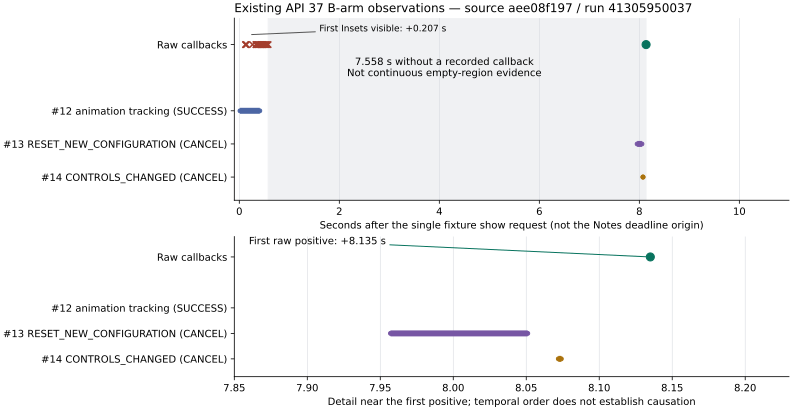

# API37 输入法重建与迟到区域的离线时间线

本轮重放已有 `aee08f1976f29ebcb62ddd15d37ae30663445228`、[运行41305950037](https://github.com/ecojust/Agent-OS/actions/runs/41305950037)的原件，没有再次执行API37实验。上一轮B组在show后8135ms取得唯一正回调；这次从当时已保存的完整IME dump发现更具体的线索：其前178ms出现 `RESET_NEW_CONFIGURATION` 追踪记录，前63ms出现 `CONTROLS_CHANGED` 记录。

原始两组结果仍为A失败、B通过本专项，设置0→1→0已恢复。新离线分析不能改变原清单、增加回调或把原Notes24通过/8失败标成修复。

## 时钟、记录含义与原件范围

原件来自不可变归档提交 `73fa7067db671a2d66c52db32bae81bf021eff63`。分析器核对来源、Git原字节、清单摘要和完整命令输出，然后从原始marker、fixture回执与IME历史重算时间线；分析程序来源和被分析运行来源分别记录。格式、命令完整性或时间语义不足时保留未知，不把未知解析成“没有事件”。

固定frameworks/base `94b4c163b7dfe5ce3607f7bb8456f9573f7de57d` 的 `ImeTrackerService` 用 `SystemClock.elapsedRealtime()` 记录起点及完成时间。原raw和fixture也使用该设备单调时钟，因此按这份实现和格式可以计算相对时间。宿主命令UTC、设备wall clock及历史打印顺序不用于代替它。系统镜像与固定源码未逐字核同，源码解释的边界保留。

Tracker的已完成历史按 `complete()` 写入顺序保存，不保证开始时间或实际完成时间排序。取消和超时项照常保留；`STATUS_CANCEL` 表示追踪请求结束，不能解释成界面回滚、键盘消失或重建没有发生。历史token文本和requestWindowName不用于证明与raw Binder相同。

## 既有原件中的关键观测

下面均来自B组的原fixture、raw marker及54,488字节IME命令原件。相对时间以本实验唯一show请求49126ms为0；“完成”值为已结束追踪项的起点加duration。

| 记录 | 设备elapsed时间（ms） | 相对show（ms） | 可证含义 |
| --- | ---: | ---: | --- |
| Fixture唯一show请求 | 49126 | 0 | 请求被接受，未增加第二次请求 |
| Fixture首次Insets可见 | 49333 | 207 | 可见性事件，非有效触摸区域证明 |
| Tracker #12 完成 | 49535 | 409 | 原因IME_REQUESTED_CHANGED_LISTENER，动画显示追踪SUCCESS |
| raw seq42 | 49537 | 411 | 候选区域仍为空，说明动画完成追踪不能代替区域判断 |
| raw seq52 | 49703 | 577 | 最后一条已记录的负候选回调 |
| Tracker #13 开始 / 完成 | 57083 / 57177 | 7957 / 8051 | ORIGIN_IME、RESET_NEW_CONFIGURATION，STATUS_CANCEL |
| Tracker #14 开始 / 完成 | 57198 / 57200 | 8072 / 8074 | CONTROLS_CHANGED，STATUS_CANCEL |
| raw seq53 | 57261 | 8135 | 唯一满足原四项条件的回调 |

seq52→seq53间隔7558ms，没有新回调被记录。不能据此断言整个间隔区域都为空，也不知道实际何时变为非空；记录的是接收时间。#13开始→seq53为178ms，结束→seq53为84ms；#14开始→seq53为63ms。这是时间先后关系，尚非触发原因的证明。

图中红叉为空区域候选回调，绿点为唯一正回调；横条表示已记录追踪项的起止时间，灰色区间表示没有新回调记录。下图放大最后300余毫秒；横向位置只表示时间，不表示因果。[绘图脚本](diagnostics/window-infos-timeline-2026-11-01/plot_timeline.py)读取原raw与独立源码审阅结果，未补造中间状态。

后置历史还保留一个早先开始的#7 CONTROLS_CHANGED追踪超时：起点46776ms、duration10006ms。它不属于B的唯一show动作，不能把超时时长当作B键盘加载耗时。完整分析保留它及其他历史，不只挑选与假设一致的记录。

## 源码将问题缩小到输入界面重建，但触发方仍未知

固定 `InputMethodService.resetStateForNewConfiguration()` 可移除旧Insets监听、初始化视图、恢复已开始的输入，并在先前可见且允许显示时发出 `RESET_NEW_CONFIGURATION` 的show追踪。这条路径能在fixture没有再次请求show时重建界面。

存在两个入口：目标secure设置的 `SettingsObserver.onChange()`，以及资源配置回调经 `ImsConfigurationTracker` 判断后触发。设置入口不要求资源Configuration先变化；配置入口只在其初始化、所处理标志和实际diff条件满足时重建。因此，两臂后置Configuration文本相同不能排除设置入口，也不能证明中间没有发生其他配置变化。追踪原因没有记录调用者，不能选定其中一个作为实测根因。

本次没有词典加载起止时间。已核LatinIME的Insets分支依赖子视图显示和几何，并未发现“词典就绪才能返回区域”的门槛；其中2秒等待消息只记录超时，不能据它解释本次8135ms。不会据尚未证明的词典假说增加预热、重复show或等待预算。具体固定源码URL、摘要、行号与全部15项完成历史见[独立源码审阅](diagnostics/window-infos-timeline-2026-11-01/history-source-review.json)。

## 原Notes时限的准确边界与后续任务

原v4四方法仍覆盖Calculator/Notes各关闭与空闲两态、八个API。原失败为Notes的API31/32/36/37各两态，24/8保持。其5秒从 `new NotesWait` 的确认准备起点计时，覆盖标题目标复核、可选BACK、隐藏确认和最终确认；最多4次可见采样、4次隐藏采样，间隔150ms，目标稳定600ms，阶段变化不重置预算。

本独立fixture的show后8135ms与该起点不同。此前“超过原5秒预算”的表述应准确理解为：本实验没有提供show后5秒内的有效raw正对照，**没有执行原Notes流程，不能判定它在自身deadline和采样时刻会通过或失败**。原Notes本来已有的失败不因此被回填新原因。

下一项应区分重建的两个入口及视图几何更新时刻，保留一次show和现有时限；原测试进程的Binder映射另作独立正对照。后续映射须通过实际Binder传递后在同一instrumentation进程比较，先验证ForTest注册权限及传输来源；不比较跨进程字符串，也不把ForTest当最终Accessibility清单。[原流程及映射设计审阅](diagnostics/window-infos-timeline-2026-11-01/original-process-design.json)只完成可行性核对，桥接代码、权限准入和原32项复测均尚未实施。

## 实施状态

[离线分析器](../../scripts/window_infos_timeline.py)与[20项本地测试](diagnostics/window-infos-timeline-2026-11-01/local-validation.json)已完成，既有真实原件预检通过：28个归档文件/717,192字节、22份源文件，A/B历史分别6/15项。解析结果保留A无正回调，B为show后8135ms、前回调间隔7558ms。[独立实现审查](diagnostics/window-infos-timeline-2026-11-01/implementation-review.json)确认未知终态和倒序回调时间不能产生伪完整时间线；不调用生产接受校验器来代替重算。

随后使用冻结源码对上述原件生成正式结果。本轮整体API35录像待源码冻结后单独尝试一次；它不执行本页API37离线分析，也不作为重建时序的视觉证据。未修改Android、原raw采集、设置对照、原Notes或其预算。
