# Android Test Evidence

Source run: https://github.com/ecojust/Agent-OS/actions/runs/40350942601

Source commit: `5b3436276359821bf4b5d7fb0de567a46e3223dd` · Attempt: 1

These screenshots show synthetic test scenarios. Missing screenshots and failed tests remain visible in the manifest.

| API | Job result | Screenshots | Recorded tests | Tests without screenshots |
| --- | --- | --- | --- | --- |
| 30 | failure | 29 | 27 | 8 |
| 31 | success | 30 | 27 | 8 |
| 32 | failure | 31 | 27 | 8 |
| 33 | success | 31 | 27 | 7 |
| 34 | failure | 32 | 27 | 7 |
| 35 | failure | 32 | 27 | 7 |
| 36 | failure | 32 | 27 | 7 |
| 37.0 | failure | 32 | 27 | 7 |

[Full evidence manifest](manifest.json)

## API 30

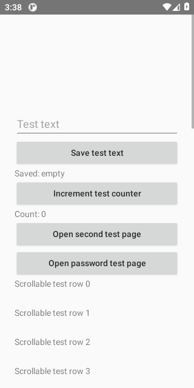

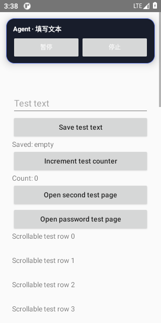

[All files and capture outcomes](api-30/screenshots/manifest.json)

## API 31

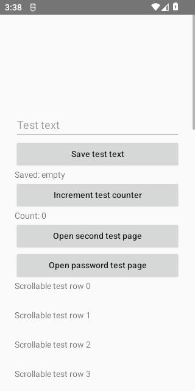

[All files and capture outcomes](api-31/screenshots/manifest.json)

## API 32

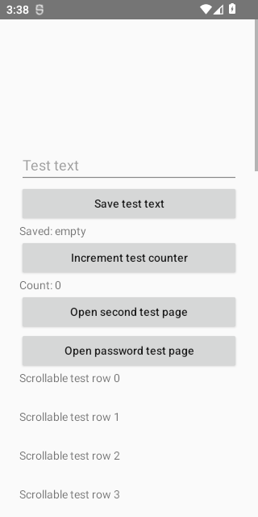

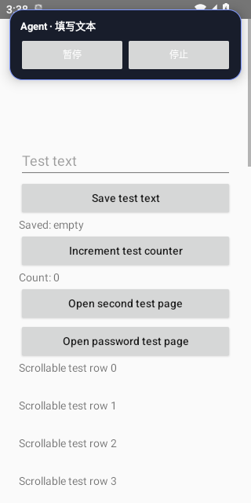

[All files and capture outcomes](api-32/screenshots/manifest.json)

## API 33

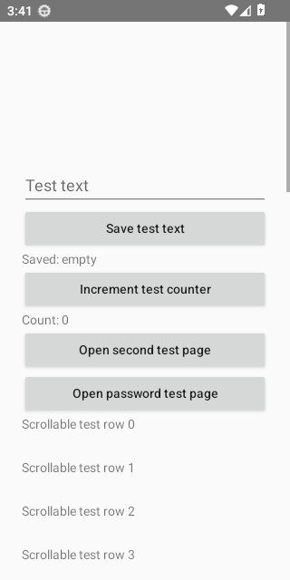

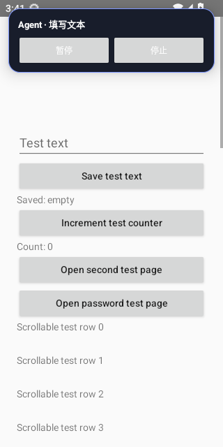

[All files and capture outcomes](api-33/screenshots/manifest.json)

## API 34

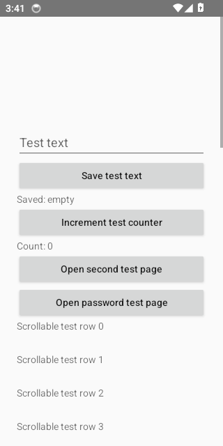

[All files and capture outcomes](api-34/screenshots/manifest.json)

## API 35

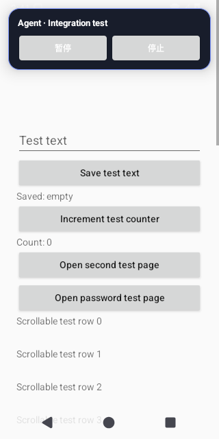

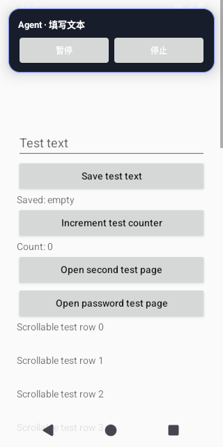

[All files and capture outcomes](api-35/screenshots/manifest.json)

## API 36

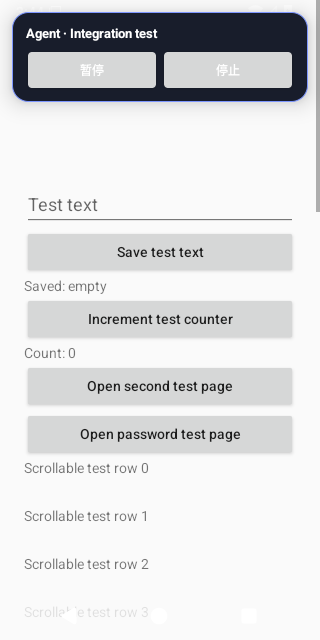

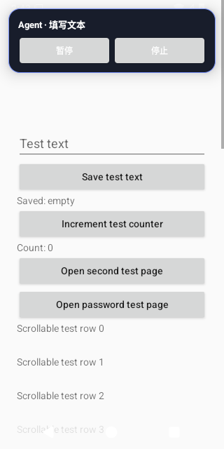

[All files and capture outcomes](api-36/screenshots/manifest.json)

## API 37.0

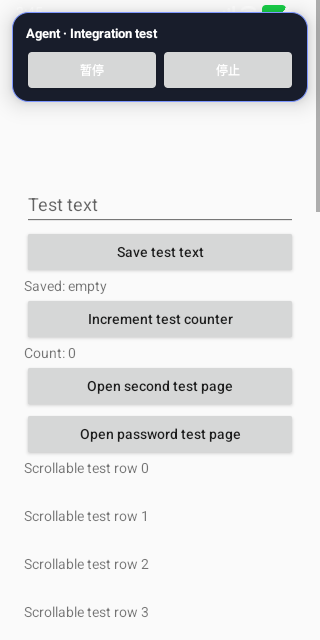

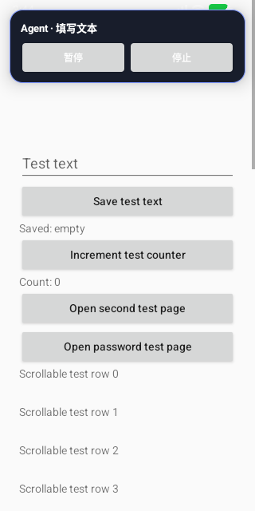

[All files and capture outcomes](api-37.0/screenshots/manifest.json)
