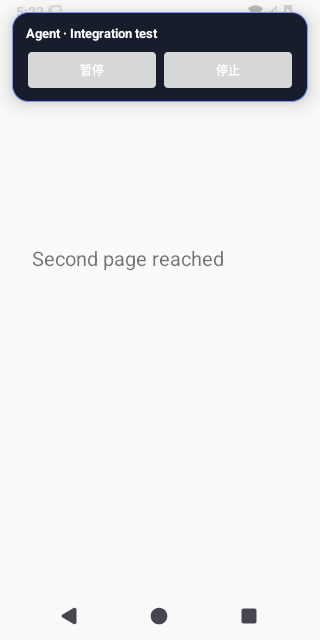

# Android Test Evidence

Source run: https://github.com/ecojust/Agent-OS/actions/runs/40367014574

Source commit: `ad99ce8c76c2998330b9565907bbca7419337b73` · Attempt: 1

These screenshots show synthetic test scenarios. Missing screenshots and failed tests remain visible in the manifest.

| API | Job result | Screenshots | Recorded tests | Tests without screenshots |
| --- | --- | --- | --- | --- |
| 30 | success | 39 | 33 | 9 |
| 31 | failure | 40 | 33 | 10 |
| 32 | success | 38 | 33 | 10 |
| 33 | failure | 41 | 33 | 8 |
| 34 | failure | 39 | 33 | 9 |
| 35 | failure | 38 | 33 | 8 |
| 36 | success | 41 | 33 | 8 |
| 37.0 | success | 41 | 33 | 8 |

[Full evidence manifest](manifest.json)

## API 30

[All files and capture outcomes](api-30/screenshots/manifest.json)

## API 31

[All files and capture outcomes](api-31/screenshots/manifest.json)

## API 32

[All files and capture outcomes](api-32/screenshots/manifest.json)

## API 33

[All files and capture outcomes](api-33/screenshots/manifest.json)

## API 34

[All files and capture outcomes](api-34/screenshots/manifest.json)

## API 35

[All files and capture outcomes](api-35/screenshots/manifest.json)

## API 36

[All files and capture outcomes](api-36/screenshots/manifest.json)

## API 37.0

[All files and capture outcomes](api-37.0/screenshots/manifest.json)
