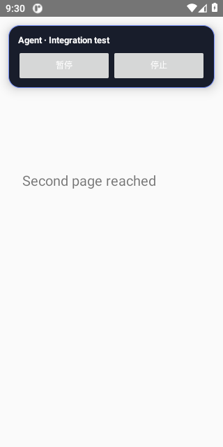
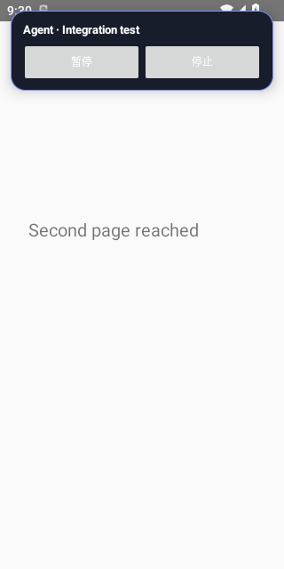
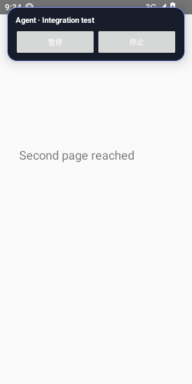
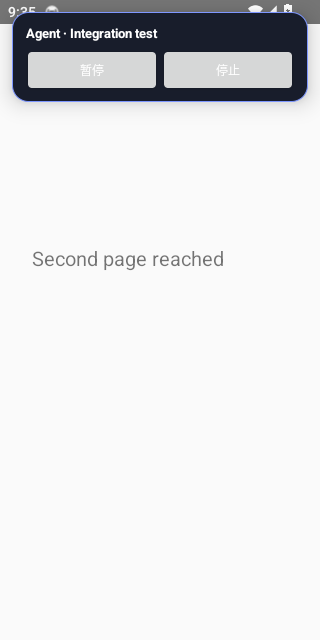
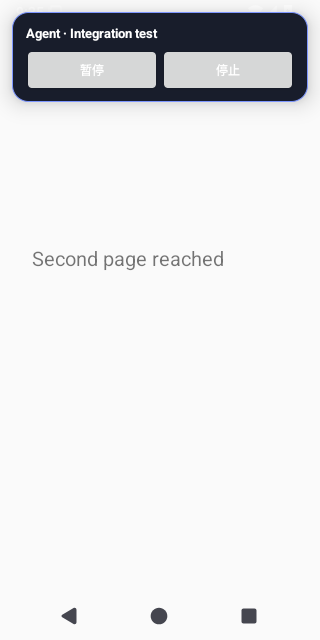
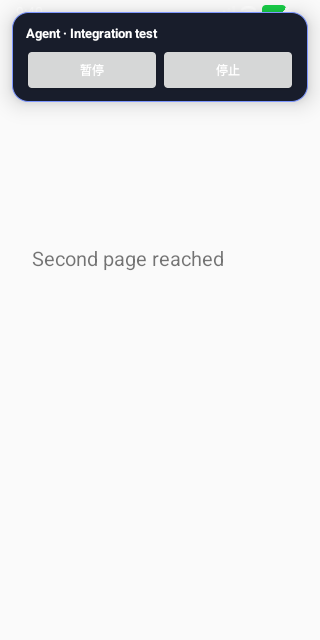

# Android Test Evidence

Source run: https://github.com/ecojust/Agent-OS/actions/runs/40404297768

Source commit: `30f8d39d0b5a082f85d04f97b4d29da78b4ee076` · Attempt: 1

These screenshots show synthetic test scenarios. Missing screenshots and failed tests remain visible in the manifest.

| API | Job result | Screenshots | Recorded tests | Tests without screenshots |
| --- | --- | --- | --- | --- |
| 30 | success | 65 | 72 | 34 |
| 31 | success | 64 | 72 | 35 |
| 32 | success | 64 | 72 | 35 |
| 33 | success | 72 | 72 | 33 |
| 34 | success | 73 | 72 | 32 |
| 35 | success | 73 | 72 | 32 |
| 36 | success | 74 | 72 | 32 |
| 37.0 | success | 73 | 72 | 32 |

[Full evidence manifest](manifest.json)

## Performance Diagnostics

Numeric diagnostic attachments are separate from screenshots and test counts. They do not establish performance-budget acceptance.

| API | Collection | Diagnostic result | Raw report |
| --- | --- | --- | --- |
| 30 | collected | passed | [JSON](performance/api-30/three-state-diagnostics.json) |
| 31 | collected | passed | [JSON](performance/api-31/three-state-diagnostics.json) |
| 32 | collected | passed | [JSON](performance/api-32/three-state-diagnostics.json) |
| 33 | collected | passed | [JSON](performance/api-33/three-state-diagnostics.json) |
| 34 | collected | passed | [JSON](performance/api-34/three-state-diagnostics.json) |
| 35 | collected | passed | [JSON](performance/api-35/three-state-diagnostics.json) |
| 36 | collected | passed | [JSON](performance/api-36/three-state-diagnostics.json) |
| 37.0 | collected | passed | [JSON](performance/api-37.0/three-state-diagnostics.json) |

## API 30

[All files and capture outcomes](api-30/screenshots/manifest.json)

## API 31

[All files and capture outcomes](api-31/screenshots/manifest.json)

## API 32

[All files and capture outcomes](api-32/screenshots/manifest.json)

## API 33

[All files and capture outcomes](api-33/screenshots/manifest.json)

## API 34

[All files and capture outcomes](api-34/screenshots/manifest.json)

## API 35

[All files and capture outcomes](api-35/screenshots/manifest.json)

## API 36

[All files and capture outcomes](api-36/screenshots/manifest.json)

## API 37.0

[All files and capture outcomes](api-37.0/screenshots/manifest.json)
