# Android Test Evidence

Source run: https://github.com/ecojust/Agent-OS/actions/runs/40481719013

Source commit: `5ea3d2c0b4455b4807f801f5f0a96178b030866a` · Attempt: 1

These screenshots show synthetic test scenarios. Missing screenshots and failed tests remain visible in the manifest.

| API | Job result | Screenshots | Recorded tests | Tests without screenshots |
| --- | --- | --- | --- | --- |
| 30 | success | 215 | 200 | 86 |
| 31 | success | 215 | 200 | 87 |
| 32 | success | 214 | 200 | 87 |
| 33 | success | 228 | 200 | 85 |
| 34 | failure | 14 | 6 | 1 |
| 35 | failure | 15 | 6 | 1 |
| 36 | failure | 16 | 6 | 1 |
| 37.0 | failure | 15 | 6 | 1 |

[Full evidence manifest](manifest.json)

## Performance Diagnostics

Numeric diagnostic attachments are separate from screenshots and test counts. They do not establish performance-budget acceptance.

| API | Collection | Diagnostic result | Raw report |
| --- | --- | --- | --- |
| 30 | collected | passed | [JSON](performance/api-30/three-state-diagnostics.json) |
| 31 | collected | passed | [JSON](performance/api-31/three-state-diagnostics.json) |
| 32 | collected | passed | [JSON](performance/api-32/three-state-diagnostics.json) |
| 33 | collected | passed | [JSON](performance/api-33/three-state-diagnostics.json) |
| 34 | invalid | None | invalid_report |
| 35 | invalid | None | invalid_report |
| 36 | invalid | None | invalid_report |
| 37.0 | invalid | None | invalid_report |

## API 30

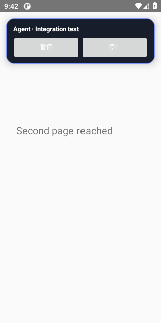

[All files and capture outcomes](api-30/screenshots/manifest.json)

## API 31

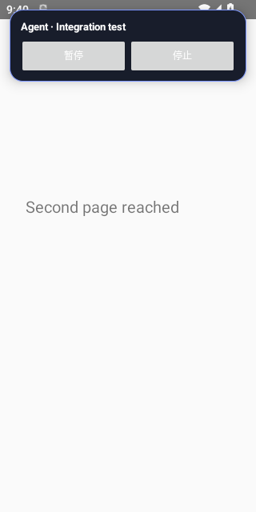

[All files and capture outcomes](api-31/screenshots/manifest.json)

## API 32

[All files and capture outcomes](api-32/screenshots/manifest.json)

## API 33

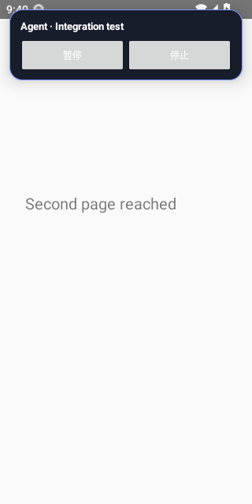

[All files and capture outcomes](api-33/screenshots/manifest.json)

## API 34

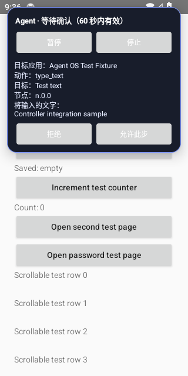

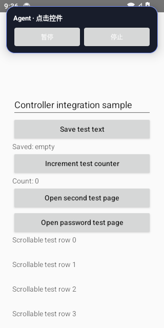

[All files and capture outcomes](api-34/screenshots/manifest.json)

## API 35

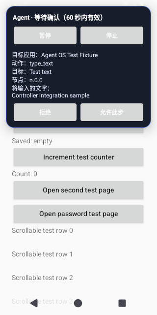

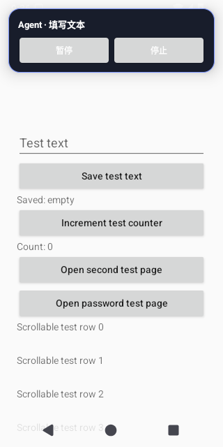

[All files and capture outcomes](api-35/screenshots/manifest.json)

## API 36

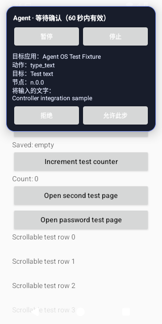

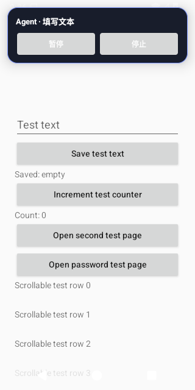

[All files and capture outcomes](api-36/screenshots/manifest.json)

## API 37.0

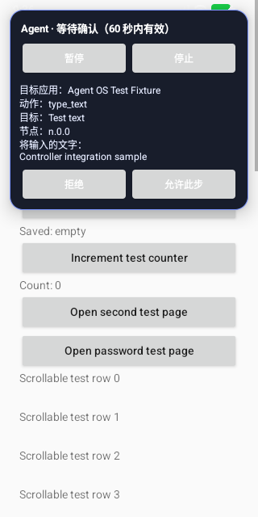

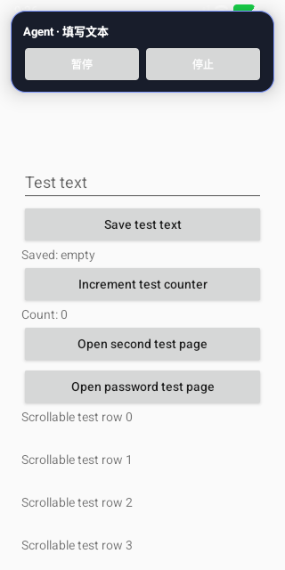

[All files and capture outcomes](api-37.0/screenshots/manifest.json)
