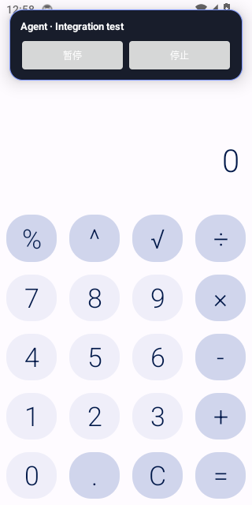
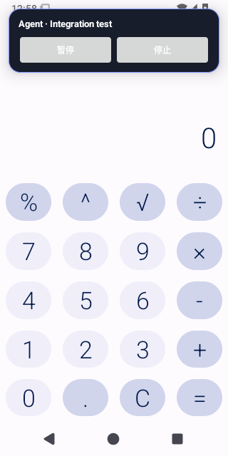
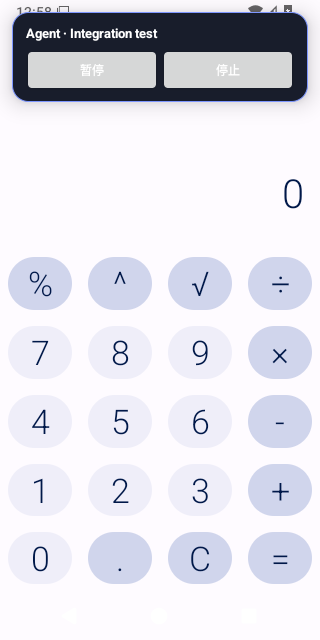
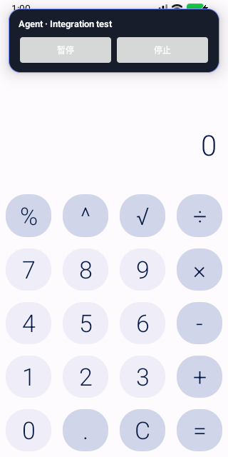

# Pinned Calculator Page Predicate Evidence

Source run: https://github.com/ecojust/Agent-OS/actions/runs/40507476898

Source commit: `0a5d1d387991f2932554dd26f1182c1aedcee59e` · Attempt: 1

Actual pinned Calculator 1.4.0 ordinary/alternate-page predicate on the production accessibility service. No production screenshot capability, buffer capture, review, disclosure, gestures or general application/device acceptance. Pinned UI images use test-only UiAutomation; standard protected/blocked records remain unchanged.

The fixed denominator is 20 cases (4 APIs × 5 cases). Failed, missing and unexecuted cases stay in this denominator.

| API | Job | Passed | Failed | Unverified | Verified pinned images |
| --- | --- | --- | --- | --- | --- |
| 34 | failure | 0 | 5 | 0 | 10 |
| 35 | failure | 0 | 5 | 0 | 10 |
| 36 | failure | 0 | 5 | 0 | 10 |
| 37.0 | failure | 0 | 5 | 0 | 10 |

[Full source, case and capture manifest](manifest.json)

## API 34

[Original driver report](api-34/report.json)

## API 35

[Original driver report](api-35/report.json)

## API 36

[Original driver report](api-36/report.json)

## API 37.0

[Original driver report](api-37.0/report.json)

