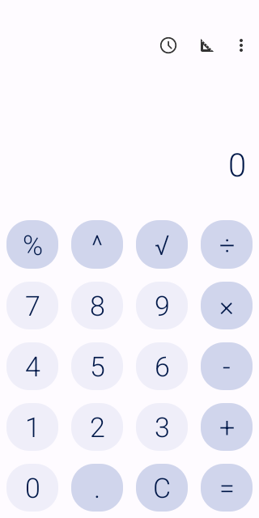
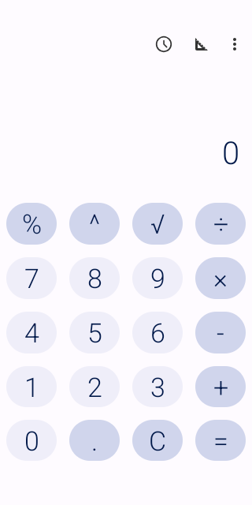
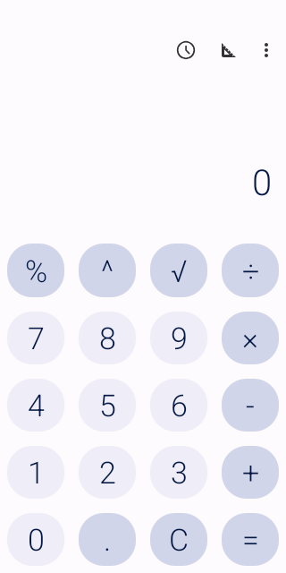

# Pinned Native Window Disclosure Evidence

Source run: https://github.com/ecojust/Agent-OS/actions/runs/40524418849

Source commit: `e63807ec2f5720029a06737073a5c6c8a5395603` · Attempt: 1

Internal visualAcceptance variant only: real production service and Controller, fixed Calculator 1.4.0, native window capture, actual same-PNG protected review, and local HTTP model-fixture delivery. Qualification uses a separate synthetic PNG challenge. Received PNG artifacts are approved HTTP payloads, not screenshots of the protected review UI. Normal debug/release capture permission remains closed. Not real-model, physical-device, general-application or physical-memory acceptance.

The fixed denominator is 8 cases (4 APIs × 2 cases). Failed, missing and unexecuted cases stay in this denominator.

| API | Job | Passed | Failed | Unverified | Verified image payloads |
| --- | --- | --- | --- | --- | --- |
| 34 | success | 2 | 0 | 0 | 1 |
| 35 | success | 2 | 0 | 0 | 1 |
| 36 | failure | 1 | 1 | 0 | 0 |
| 37.0 | success | 2 | 0 | 0 | 1 |

[Full source, case and capture manifest](manifest.json)

## API 34

[Original driver report](api-34/report.json)

## API 35

[Original driver report](api-35/report.json)

## API 36

[Original driver report](api-36/report.json)

## API 37.0

[Original driver report](api-37.0/report.json)

