# Owned Control Diagnostic Evidence

Source run: https://github.com/ecojust/Agent-OS/actions/runs/40539311569

Source commit: `e99ef4a403246ab6a64ee9e2fad1ab2680e1bf02` · Attempt: 1

These screenshots show synthetic test scenarios. Missing screenshots and failed tests remain visible in the manifest.

Execution scope: `owned-control-diagnostic`. Only `dev.agentos.app.OwnedControlWindowInstrumentedTest#changedPresentationAndCallbacksStillRevokeTheActualControlOwner` was selected.

The diagnostic denominator is 8 cases (8 APIs × 1 test); missing, skipped and unexecuted cases remain unverified. The rest of the normal suite was not run by this scope and is not counted as passed. A complete default matrix is still required for full regression acceptance.

| API | Diagnostic case result |
| --- | --- |
| 30 | failed |
| 31 | failed |
| 32 | failed |
| 33 | passed |
| 34 | passed |
| 35 | passed |
| 36 | passed |
| 37.0 | passed |

| API | Job result | Screenshots | Recorded tests | Tests without screenshots |
| --- | --- | --- | --- | --- |
| 30 | failure | 5 | 1 | 0 |
| 31 | failure | 5 | 1 | 0 |
| 32 | failure | 5 | 1 | 0 |
| 33 | success | 5 | 1 | 0 |
| 34 | success | 5 | 1 | 0 |
| 35 | success | 5 | 1 | 0 |
| 36 | success | 5 | 1 | 0 |
| 37.0 | success | 5 | 1 | 0 |

[Full evidence manifest](manifest.json)

## Performance Diagnostics

Numeric diagnostic attachments are separate from screenshots and test counts. They do not establish performance-budget acceptance.

| API | Collection | Diagnostic result | Raw report |
| --- | --- | --- | --- |
| 30 | invalid | None | invalid_report |
| 31 | invalid | None | invalid_report |
| 32 | invalid | None | invalid_report |
| 33 | invalid | None | invalid_report |
| 34 | invalid | None | invalid_report |
| 35 | invalid | None | invalid_report |
| 36 | invalid | None | invalid_report |
| 37.0 | invalid | None | invalid_report |

## API 30

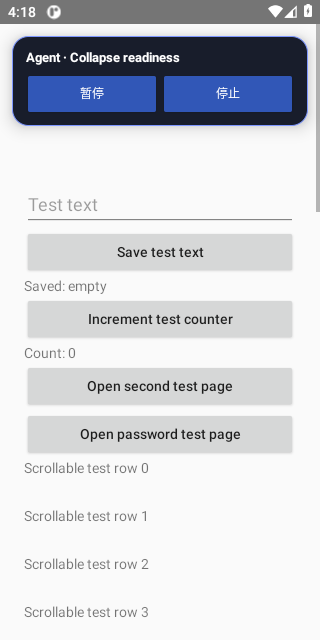

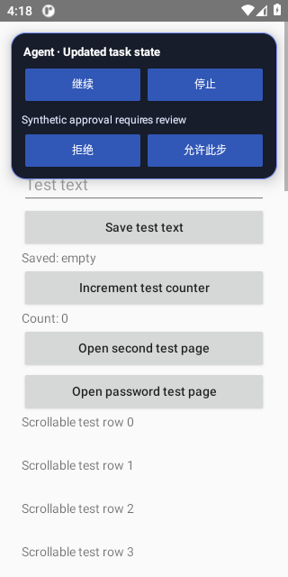

[All files and capture outcomes](api-30/screenshots/manifest.json)

## API 31

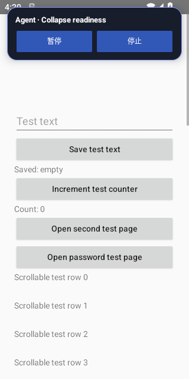

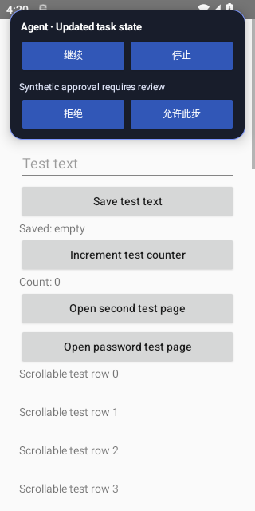

[All files and capture outcomes](api-31/screenshots/manifest.json)

## API 32

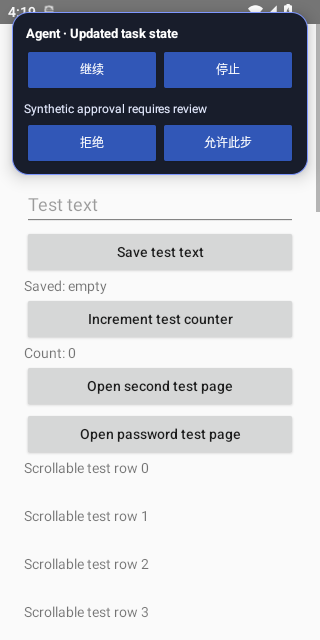

[All files and capture outcomes](api-32/screenshots/manifest.json)

## API 33

[All files and capture outcomes](api-33/screenshots/manifest.json)

## API 34

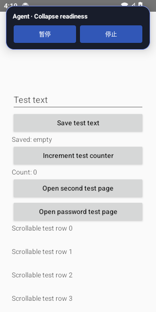

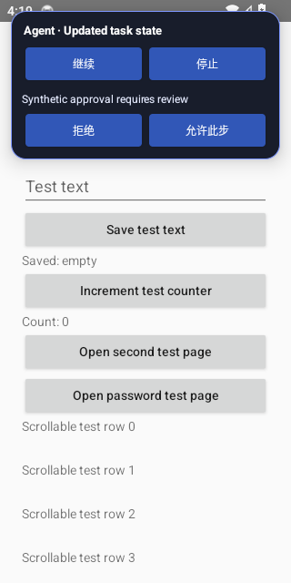

[All files and capture outcomes](api-34/screenshots/manifest.json)

## API 35

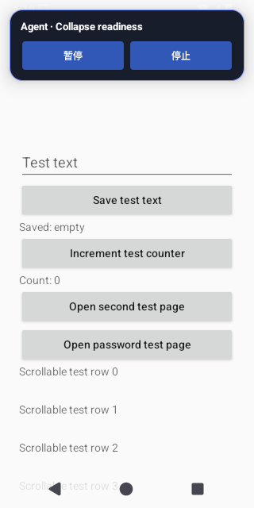

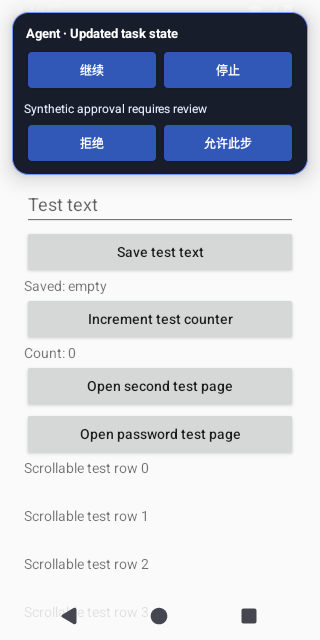

[All files and capture outcomes](api-35/screenshots/manifest.json)

## API 36

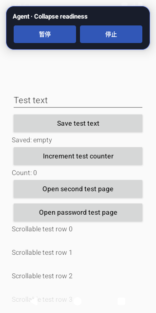

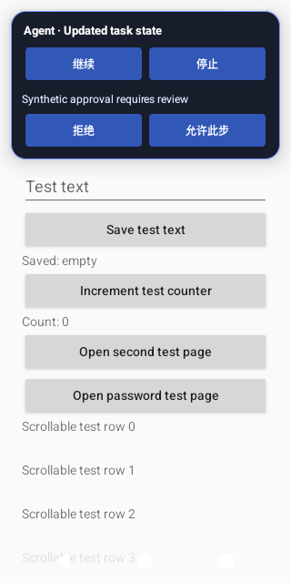

[All files and capture outcomes](api-36/screenshots/manifest.json)

## API 37.0

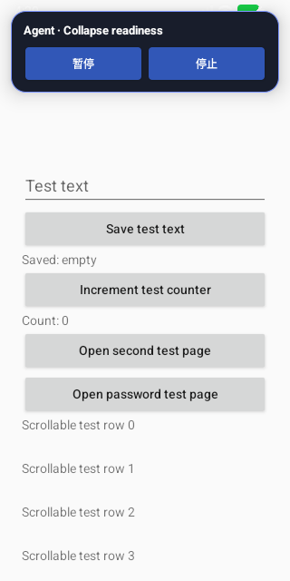

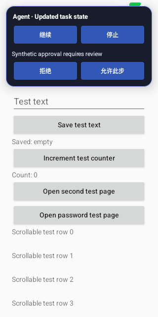

[All files and capture outcomes](api-37.0/screenshots/manifest.json)
