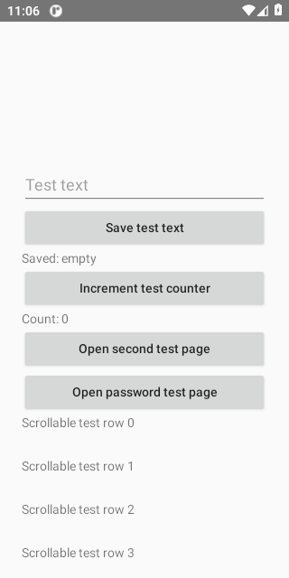
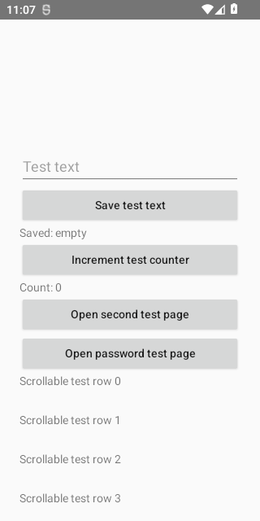
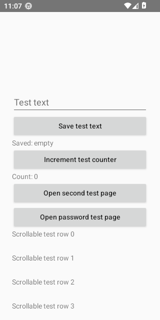
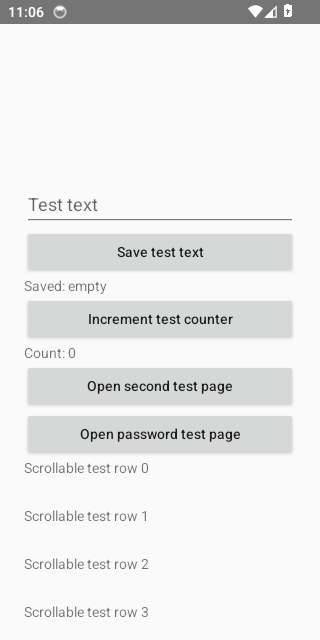
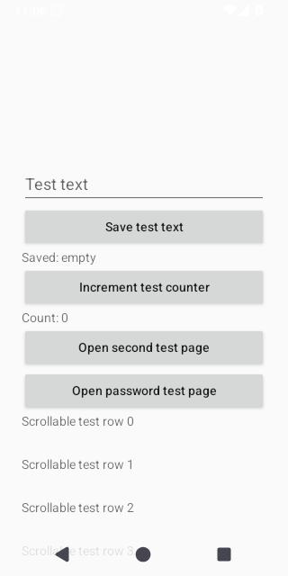
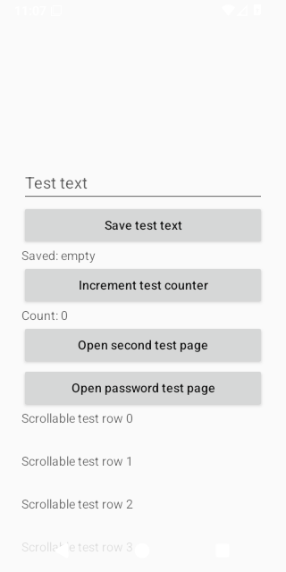
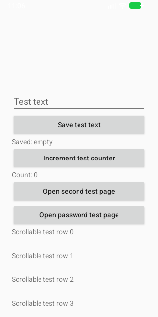

# Idle Pair Diagnostic Evidence

Source run: https://github.com/ecojust/Agent-OS/actions/runs/41044860496

Source commit: `084d596e00b50ca7cea603f6eaf94ad1c1a2dd64` · Attempt: 1

These screenshots show synthetic test scenarios. Missing screenshots and failed tests remain visible in the manifest.

This case samples six service-off/service-on-idle pairs in AB/BA alternating order on each dedicated emulator, with the instrumented Agent process resident and the same synthetic Fixture in the foreground. The numeric denominator is 48 planned pairs and 96 windows across eight APIs, separate from the eight selected test cases. Missing, failed and unexecuted measurements remain explicit. Screenshots are outside the sampling windows; they do not prove the measured CPU/PSS. Target-process resources, real-device budgets and long-duration stability remain unverified.

Execution scope: `idle-pair-diagnostic`. Only `dev.agentos.app.IdlePairedPerformanceInstrumentedTest#collectAlternatingServiceOffAndIdlePairs` was selected.

The diagnostic denominator is 8 cases (8 APIs × 1 test); missing, skipped and unexecuted cases remain unverified. The rest of the normal suite was not run by this scope and is not counted as passed. A complete default matrix is still required for full regression acceptance.

| API | Diagnostic case result |
| --- | --- |
| 30 | passed |
| 31 | passed |
| 32 | passed |
| 33 | passed |
| 34 | passed |
| 35 | passed |
| 36 | passed |
| 37.0 | passed |

| API | Job result | Screenshots | Recorded tests | Tests without screenshots |
| --- | --- | --- | --- | --- |
| 30 | success | 2 | 1 | 0 |
| 31 | success | 2 | 1 | 0 |
| 32 | success | 2 | 1 | 0 |
| 33 | success | 2 | 1 | 0 |
| 34 | success | 2 | 1 | 0 |
| 35 | success | 2 | 1 | 0 |
| 36 | success | 2 | 1 | 0 |
| 37.0 | success | 3 | 1 | 0 |

[Full evidence manifest](manifest.json)

## Performance Diagnostics

Numeric diagnostic attachments are separate from screenshots and test counts. They do not establish performance-budget acceptance.

| API | Collection | Diagnostic result | Raw report |
| --- | --- | --- | --- |
| 30 | invalid | None | invalid_report |
| 31 | invalid | None | invalid_report |
| 32 | invalid | None | invalid_report |
| 33 | invalid | None | invalid_report |
| 34 | invalid | None | invalid_report |
| 35 | invalid | None | invalid_report |
| 36 | invalid | None | invalid_report |
| 37.0 | invalid | None | invalid_report |

## Alternating Idle Pair Diagnostics

Six planned pairs per API remain in the denominator, including absent or failed numeric reports. The original selected-case and workflow conclusions are unchanged; diagnostic data does not establish a performance budget.

| API | Collection | Diagnostic result | Raw report |
| --- | --- | --- | --- |
| 30 | collected | passed | [JSON](idle-paired-performance/api-30/idle-paired-diagnostics.json) |
| 31 | collected | passed | [JSON](idle-paired-performance/api-31/idle-paired-diagnostics.json) |
| 32 | collected | passed | [JSON](idle-paired-performance/api-32/idle-paired-diagnostics.json) |
| 33 | collected | passed | [JSON](idle-paired-performance/api-33/idle-paired-diagnostics.json) |
| 34 | collected | passed | [JSON](idle-paired-performance/api-34/idle-paired-diagnostics.json) |
| 35 | collected | passed | [JSON](idle-paired-performance/api-35/idle-paired-diagnostics.json) |
| 36 | collected | passed | [JSON](idle-paired-performance/api-36/idle-paired-diagnostics.json) |
| 37.0 | collected | passed | [JSON](idle-paired-performance/api-37.0/idle-paired-diagnostics.json) |

## API 30

[All files and capture outcomes](api-30/screenshots/manifest.json)

## API 31

[All files and capture outcomes](api-31/screenshots/manifest.json)

## API 32

[All files and capture outcomes](api-32/screenshots/manifest.json)

## API 33

[All files and capture outcomes](api-33/screenshots/manifest.json)

## API 34

[All files and capture outcomes](api-34/screenshots/manifest.json)

## API 35

[All files and capture outcomes](api-35/screenshots/manifest.json)

## API 36

[All files and capture outcomes](api-36/screenshots/manifest.json)

## API 37.0

[All files and capture outcomes](api-37.0/screenshots/manifest.json)
