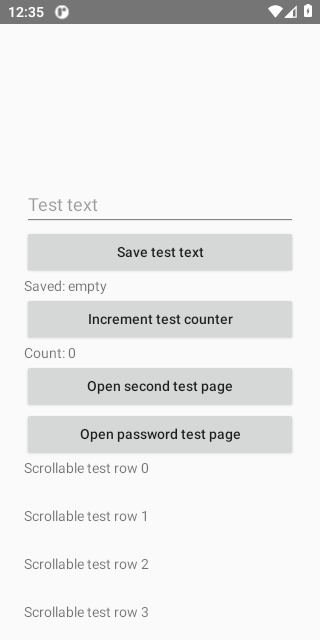
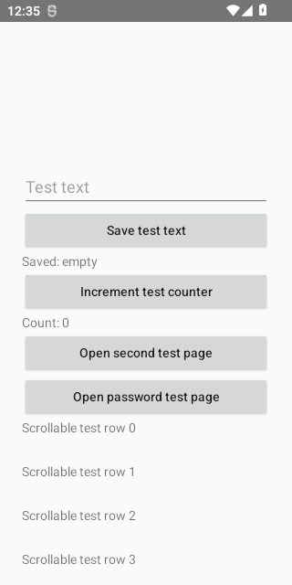
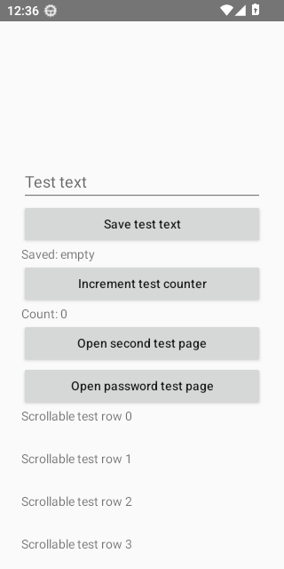
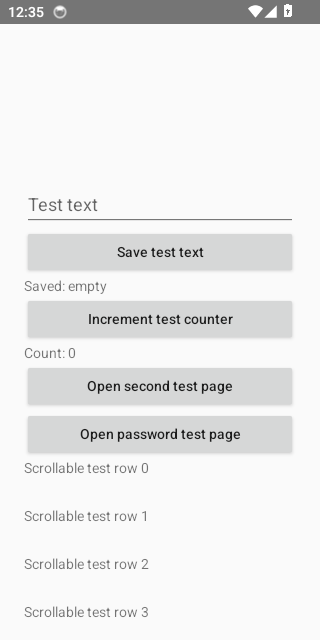
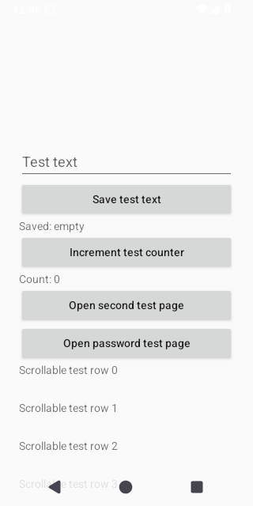
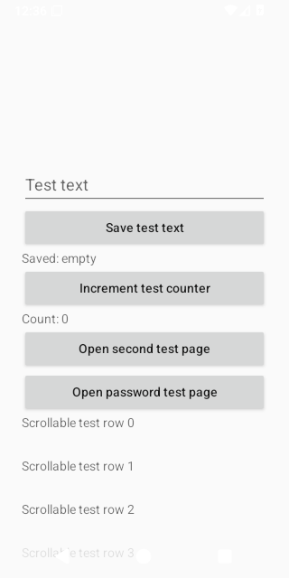
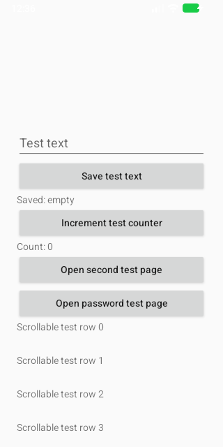

# Segmented Stress Diagnostic Evidence

Source run: https://github.com/ecojust/Agent-OS/actions/runs/41052540296

Source commit: `054be1f34f552771fb874eee6609f5d40f3466e3` · Attempt: 1

These screenshots show synthetic test scenarios. Missing screenshots and failed tests remain visible in the manifest.

This fixed diagnostic plans 30 segments per dedicated emulator, each at least 60 seconds and including one completed synthetic task, one pending-approval stop and at least 10 seconds of service-off recovery. The numeric denominator is 240 planned segments and 480 planned tasks across eight APIs, separate from eight selected cases. Only atomically committed segment files are collected; incomplete, failed and absent measurements remain explicit. The measured resident Agent process includes instrumentation and the local model, excludes Fixture resources, and does not establish CPU saturation, leak absence, system-wide stability or physical-device performance budgets.

Execution scope: `stress-diagnostic`. Only `dev.agentos.app.SegmentedStressInstrumentedTest#collectThirtyMinuteTaskStopAndServiceCycles` was selected.

The diagnostic denominator is 8 cases (8 APIs × 1 test); missing, skipped and unexecuted cases remain unverified. The rest of the normal suite was not run by this scope and is not counted as passed. A complete default matrix is still required for full regression acceptance.

| API | Diagnostic case result |
| --- | --- |
| 30 | passed |
| 31 | passed |
| 32 | passed |
| 33 | passed |
| 34 | passed |
| 35 | passed |
| 36 | passed |
| 37.0 | passed |

| API | Job result | Screenshots | Recorded tests | Tests without screenshots |
| --- | --- | --- | --- | --- |
| 30 | success | 3 | 1 | 0 |
| 31 | success | 3 | 1 | 0 |
| 32 | success | 2 | 1 | 0 |
| 33 | success | 2 | 1 | 0 |
| 34 | success | 3 | 1 | 0 |
| 35 | success | 2 | 1 | 0 |
| 36 | success | 3 | 1 | 0 |
| 37.0 | success | 2 | 1 | 0 |

[Full evidence manifest](manifest.json)

## Performance Diagnostics

Numeric diagnostic attachments are separate from screenshots and test counts. They do not establish performance-budget acceptance.

| API | Collection | Diagnostic result | Raw report |
| --- | --- | --- | --- |
| 30 | invalid | None | invalid_report |
| 31 | invalid | None | invalid_report |
| 32 | invalid | None | invalid_report |
| 33 | invalid | None | invalid_report |
| 34 | invalid | None | invalid_report |
| 35 | invalid | None | invalid_report |
| 36 | invalid | None | invalid_report |
| 37.0 | invalid | None | invalid_report |

## Segmented Stress Diagnostics

Each API retains its planned 30 segments and 60 tasks, including failure, interruption and unavailable reports. An incomplete root report is a committed prefix, not a completed 30-minute test. Later planned slots have no committed evidence and are not inferred to be unexecuted. Original selected-case and job conclusions remain unchanged; numerical data is not performance-budget acceptance.

| API | Collection | Diagnostic result | Raw report |
| --- | --- | --- | --- |
| 30 | collected | passed | [JSON](segmented-stress/api-30/stress-diagnostics.json) |
| 31 | collected | passed | [JSON](segmented-stress/api-31/stress-diagnostics.json) |
| 32 | collected | passed | [JSON](segmented-stress/api-32/stress-diagnostics.json) |
| 33 | collected | passed | [JSON](segmented-stress/api-33/stress-diagnostics.json) |
| 34 | collected | passed | [JSON](segmented-stress/api-34/stress-diagnostics.json) |
| 35 | collected | passed | [JSON](segmented-stress/api-35/stress-diagnostics.json) |
| 36 | collected | passed | [JSON](segmented-stress/api-36/stress-diagnostics.json) |
| 37.0 | collected | passed | [JSON](segmented-stress/api-37.0/stress-diagnostics.json) |

## API 30

[All files and capture outcomes](api-30/screenshots/manifest.json)

## API 31

[All files and capture outcomes](api-31/screenshots/manifest.json)

## API 32

[All files and capture outcomes](api-32/screenshots/manifest.json)

## API 33

[All files and capture outcomes](api-33/screenshots/manifest.json)

## API 34

[All files and capture outcomes](api-34/screenshots/manifest.json)

## API 35

[All files and capture outcomes](api-35/screenshots/manifest.json)

## API 36

[All files and capture outcomes](api-36/screenshots/manifest.json)

## API 37.0

[All files and capture outcomes](api-37.0/screenshots/manifest.json)
