# Active Task Pair Diagnostic Evidence

Source run: https://github.com/ecojust/Agent-OS/actions/runs/41059787334

Source commit: `8d03874521ddaeead53c6494fd72265099d0f993` · Attempt: 1

These screenshots show synthetic test scenarios. Missing screenshots and failed tests remain visible in the manifest.

This fixed diagnostic plans six AC/CA alternating pairs per dedicated emulator, with five fresh tasks per arm. Across eight APIs the numeric denominator is 48 planned pairs, 96 arms and 480 trials, distinct from eight selected cases. A uses scripted accessibility actions on real Fixture controls with the Agent service off; it is not human, touch or IME timing. C uses the real Agent controller and local test model. Task CPU and elapsed time exclude setup and endpoint PSS probes. Only atomically committed trials are collected; interrupted prefixes and failed or absent results remain explicit. The resident instrumented process includes the same-process model, excludes Fixture resources, and does not establish steady-state or peak PSS, causal overhead, real-model or physical-device budgets.

Execution scope: `active-pair-diagnostic`. Only `dev.agentos.app.ActivePairedPerformanceInstrumentedTest#collectAlternatingEquivalentManualAndAgentTasks` was selected.

The diagnostic denominator is 8 cases (8 APIs × 1 test); missing, skipped and unexecuted cases remain unverified. The rest of the normal suite was not run by this scope and is not counted as passed. A complete default matrix is still required for full regression acceptance.

| API | Diagnostic case result |
| --- | --- |
| 30 | passed |
| 31 | passed |
| 32 | passed |
| 33 | passed |
| 34 | passed |
| 35 | passed |
| 36 | passed |
| 37.0 | passed |

| API | Job result | Screenshots | Recorded tests | Tests without screenshots |
| --- | --- | --- | --- | --- |
| 30 | success | 3 | 1 | 0 |
| 31 | success | 2 | 1 | 0 |
| 32 | success | 2 | 1 | 0 |
| 33 | success | 2 | 1 | 0 |
| 34 | success | 3 | 1 | 0 |
| 35 | success | 3 | 1 | 0 |
| 36 | success | 3 | 1 | 0 |
| 37.0 | success | 2 | 1 | 0 |

[Full evidence manifest](manifest.json)

## Performance Diagnostics

Numeric diagnostic attachments are separate from screenshots and test counts. They do not establish performance-budget acceptance.

| API | Collection | Diagnostic result | Raw report |
| --- | --- | --- | --- |
| 30 | invalid | None | invalid_report |
| 31 | invalid | None | invalid_report |
| 32 | invalid | None | invalid_report |
| 33 | invalid | None | invalid_report |
| 34 | invalid | None | invalid_report |
| 35 | invalid | None | invalid_report |
| 36 | invalid | None | invalid_report |
| 37.0 | invalid | None | invalid_report |

## Active Equivalent Task Pair Diagnostics

Each API retains six pairs and 60 planned trials, including failure, interruption and unavailable reports. An incomplete root report proves only its committed prefix; later trials are unavailable, not asserted unexecuted. Manual platform action accepts and Agent model-acknowledged writes are separate counts. PSS records are pre/post endpoints outside task timing, not steady-state or peak measurements. Original selected-case and job conclusions remain unchanged; diagnostics do not establish performance-budget acceptance.

| API | Collection | Diagnostic result | Raw report |
| --- | --- | --- | --- |
| 30 | collected | passed | [JSON](active-task-pairs/api-30/active-paired-diagnostics.json) |
| 31 | collected | passed | [JSON](active-task-pairs/api-31/active-paired-diagnostics.json) |
| 32 | collected | passed | [JSON](active-task-pairs/api-32/active-paired-diagnostics.json) |
| 33 | collected | passed | [JSON](active-task-pairs/api-33/active-paired-diagnostics.json) |
| 34 | collected | passed | [JSON](active-task-pairs/api-34/active-paired-diagnostics.json) |
| 35 | collected | passed | [JSON](active-task-pairs/api-35/active-paired-diagnostics.json) |
| 36 | collected | passed | [JSON](active-task-pairs/api-36/active-paired-diagnostics.json) |
| 37.0 | collected | passed | [JSON](active-task-pairs/api-37.0/active-paired-diagnostics.json) |

## API 30

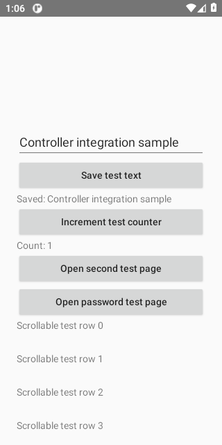

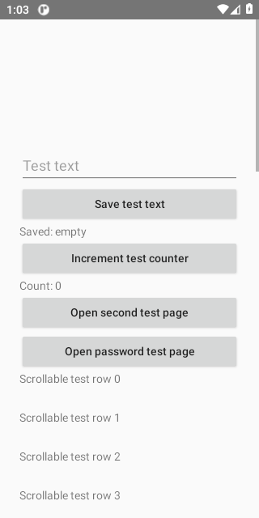

[All files and capture outcomes](api-30/screenshots/manifest.json)

## API 31

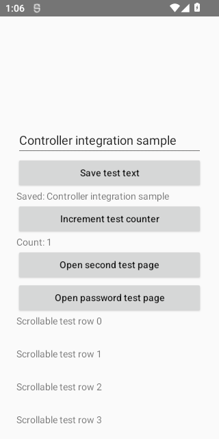

[All files and capture outcomes](api-31/screenshots/manifest.json)

## API 32

[All files and capture outcomes](api-32/screenshots/manifest.json)

## API 33

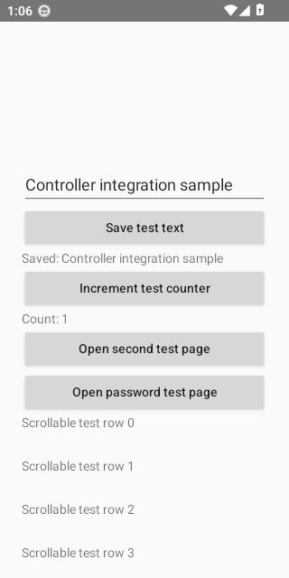

[All files and capture outcomes](api-33/screenshots/manifest.json)

## API 34

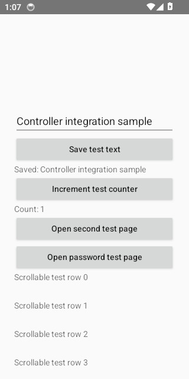

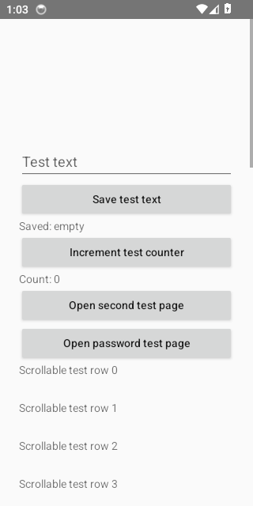

[All files and capture outcomes](api-34/screenshots/manifest.json)

## API 35

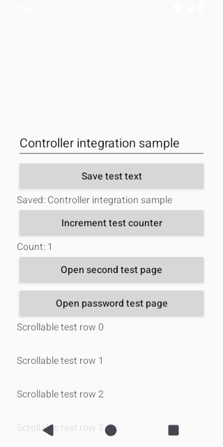

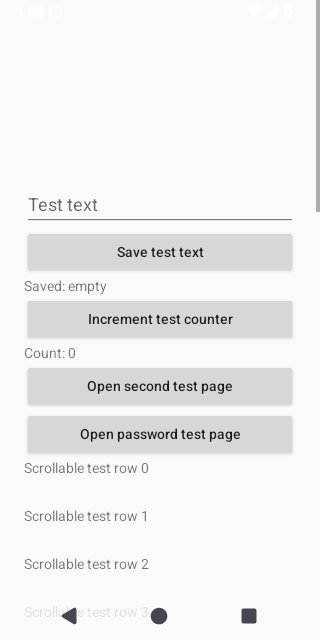

[All files and capture outcomes](api-35/screenshots/manifest.json)

## API 36

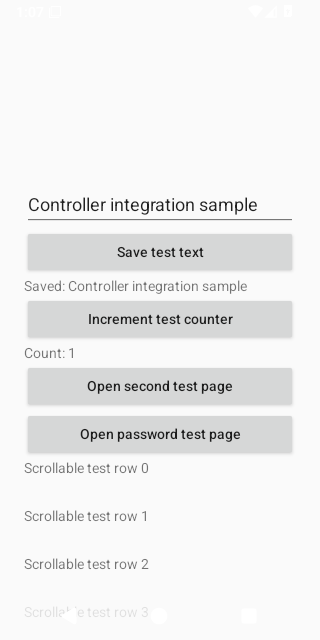

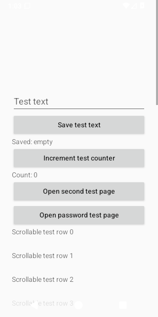

[All files and capture outcomes](api-36/screenshots/manifest.json)

## API 37.0

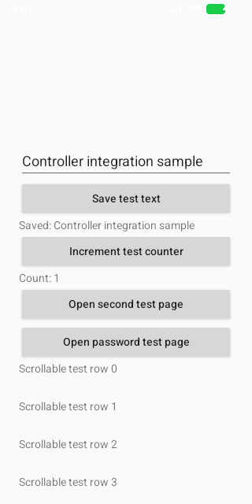

[All files and capture outcomes](api-37.0/screenshots/manifest.json)
