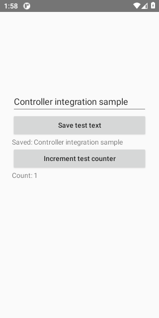
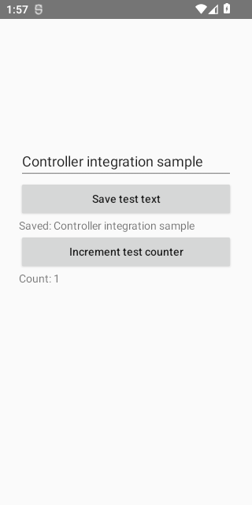
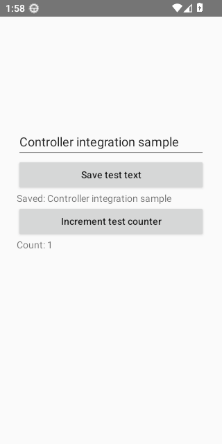
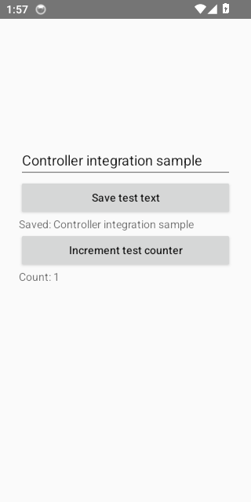
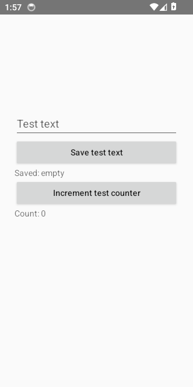
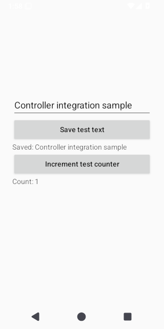
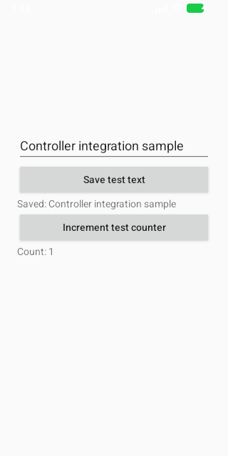

# App Experience Pilot Diagnostic Evidence

Source run: https://github.com/ecojust/Agent-OS/actions/runs/41067237848

Source commit: `5be02c1c4c2ddf0fe60e0a2c7e2eb5190eec03d8` · Attempt: 1

These screenshots show synthetic test scenarios. Missing screenshots and failed tests remain visible in the manifest.

Target Fixture and resident Agent CPU/PSS are measured separately. Startup uses matched Perfetto android_startups time_to_display observations; am start output and frame callbacks do not substitute for TTID. Raw launch, resource and frame reports, bounded compressed traces, failed and unavailable results are retained. Manual accessibility actions and local test-model actions are synthetic; endpoint PSS is not steady-state or peak memory, and received FrameMetrics do not prove presentation. These diagnostics do not establish causal overhead, real-model, physical-device or performance-budget acceptance. Pilot and formal results are separate profiles.

Execution scope: `app-experience-pilot`. Only `dev.agentos.app.AppExperienceInstrumentedTest#collectTargetResourcesStartupAndFrames` was selected.

The diagnostic denominator is 8 cases (8 APIs × 1 test); missing, skipped and unexecuted cases remain unverified. The rest of the normal suite was not run by this scope and is not counted as passed. A complete default matrix is still required for full regression acceptance.

| API | Diagnostic case result |
| --- | --- |
| 30 | failed |
| 31 | failed |
| 32 | unverified |
| 33 | failed |
| 34 | failed |
| 35 | failed |
| 36 | unverified |
| 37.0 | failed |

| API | Job result | Screenshots | Recorded tests | Tests without screenshots |
| --- | --- | --- | --- | --- |
| 30 | failure | 2 | 1 | 0 |
| 31 | failure | 2 | 1 | 0 |
| 32 | failure | 2 | 1 | 0 |
| 33 | failure | 2 | 1 | 0 |
| 34 | failure | 3 | 1 | 0 |
| 35 | failure | 2 | 1 | 0 |
| 36 | failure | 0 | 0 | 0 |
| 37.0 | failure | 2 | 1 | 0 |

[Full evidence manifest](manifest.json)

## Performance Diagnostics

Numeric diagnostic attachments are separate from screenshots and test counts. They do not establish performance-budget acceptance.

| API | Collection | Diagnostic result | Raw report |
| --- | --- | --- | --- |
| 30 | invalid | None | invalid_report |
| 31 | invalid | None | invalid_report |
| 32 | invalid | None | invalid_report |
| 33 | invalid | None | invalid_report |
| 34 | invalid | None | invalid_report |
| 35 | invalid | None | invalid_report |
| 36 | not_collected | None | emulator_script_did_not_finish |
| 37.0 | invalid | None | invalid_report |

## App Experience Diagnostics

Profile: `pilot`. Pilot data does not count toward the formal denominator. The original instrumented report status is separate from the complete evidence status, which also requires valid TTID and trace evidence. Missing, failed and incomplete data remain in the planned eight-API denominator. Only committed launch and trial prefixes are known; later entries are unavailable, not asserted unexecuted.

| API | Collection | Evidence result | Instrumented report | Raw report |
| --- | --- | --- | --- | --- |
| 30 | collected | failed | failed | [JSON](app-experience/api-30/experience-diagnostics.json) |
| 31 | collected | failed | failed | [JSON](app-experience/api-31/experience-diagnostics.json) |
| 32 | collected | failed | passed | [JSON](app-experience/api-32/experience-diagnostics.json) |
| 33 | collected | failed | failed | [JSON](app-experience/api-33/experience-diagnostics.json) |
| 34 | collected | failed | failed | [JSON](app-experience/api-34/experience-diagnostics.json) |
| 35 | collected | failed | failed | [JSON](app-experience/api-35/experience-diagnostics.json) |
| 36 | not_collected | unavailable | None | emulator_script_did_not_finish |
| 37.0 | collected | failed | failed | [JSON](app-experience/api-37.0/experience-diagnostics.json) |

## API 30

[All files and capture outcomes](api-30/screenshots/manifest.json)

## API 31

[All files and capture outcomes](api-31/screenshots/manifest.json)

## API 32

[All files and capture outcomes](api-32/screenshots/manifest.json)

## API 33

[All files and capture outcomes](api-33/screenshots/manifest.json)

## API 34

[All files and capture outcomes](api-34/screenshots/manifest.json)

## API 35

[All files and capture outcomes](api-35/screenshots/manifest.json)

## API 37.0

[All files and capture outcomes](api-37.0/screenshots/manifest.json)
