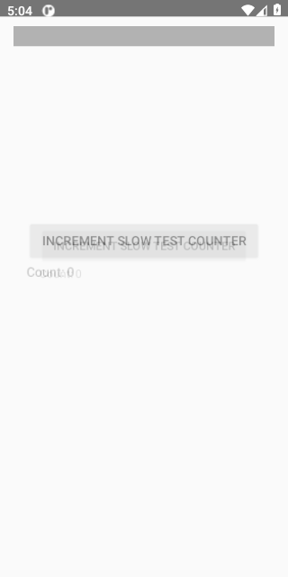
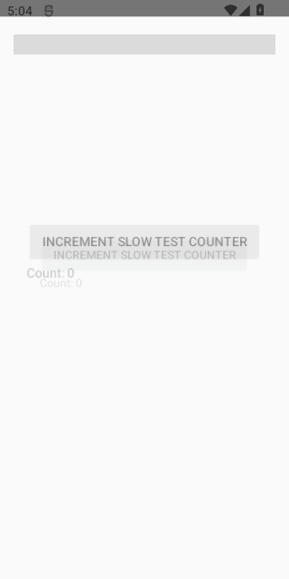
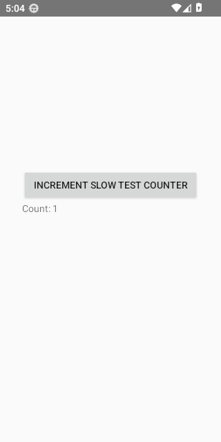
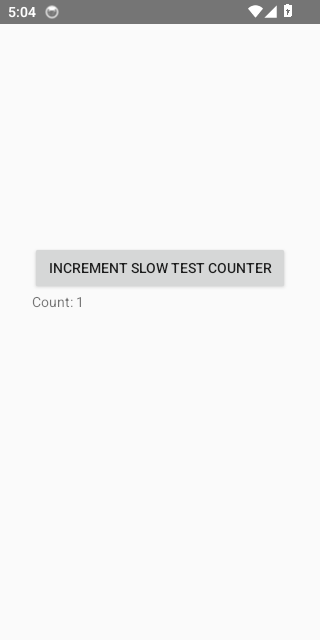
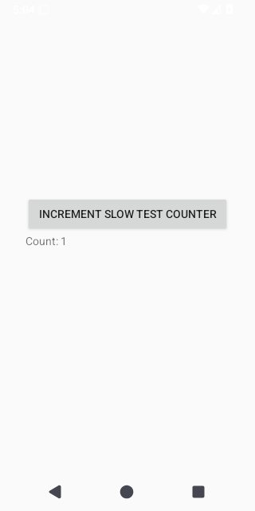
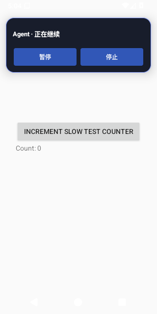
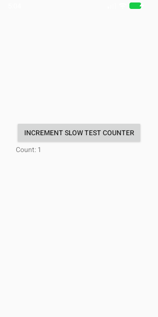

# Busy Stop Pilot Diagnostic Evidence

Source run: https://github.com/ecojust/Agent-OS/actions/runs/41095210851

Source commit: `f899bc435557618738173d0876fe9adb2686636d` · Attempt: 1

These screenshots show synthetic test scenarios. Missing screenshots and failed tests remain visible in the manifest.

Two separate controlled scenarios use the real controller and actual stop buttons: an in-flight Fixture platform action stopped from the overlay, and a held local HTTP model reply stopped from MainActivity. Pilot plans two stops per scenario/API; formal plans one hundred, or 1600 stops across eight APIs. Cancellation-observed bounds, platform-call return, target effect and ticket settlement remain distinct. MainActivity natural stopped-state FrameMetrics measure HWUI completion, not physical presentation; overlay removal is not a complete-frame measurement. Failed and missing planned trials remain explicit. These diagnostics do not establish physical-device, all-workload, full-suite or performance-budget acceptance.

Execution scope: `busy-stop-pilot`. Only `dev.agentos.app.BusyStopInstrumentedTest#collectBusyStopDiagnostics` was selected.

The diagnostic denominator is 8 cases (8 APIs × 1 test); missing, skipped and unexecuted cases remain unverified. The rest of the normal suite was not run by this scope and is not counted as passed. A complete default matrix is still required for full regression acceptance.

| API | Diagnostic case result |
| --- | --- |
| 30 | failed |
| 31 | failed |
| 32 | failed |
| 33 | failed |
| 34 | failed |
| 35 | failed |
| 36 | failed |
| 37.0 | failed |

| API | Job result | Screenshots | Recorded tests | Tests without screenshots |
| --- | --- | --- | --- | --- |
| 30 | failure | 1 | 1 | 0 |
| 31 | failure | 1 | 1 | 0 |
| 32 | failure | 0 | 1 | 1 |
| 33 | failure | 1 | 1 | 0 |
| 34 | failure | 1 | 1 | 0 |
| 35 | failure | 1 | 1 | 0 |
| 36 | failure | 2 | 1 | 0 |
| 37.0 | failure | 1 | 1 | 0 |

[Full evidence manifest](manifest.json)

## Performance Diagnostics

Numeric diagnostic attachments are separate from screenshots and test counts. They do not establish performance-budget acceptance.

| API | Collection | Diagnostic result | Raw report |
| --- | --- | --- | --- |
| 30 | invalid | None | invalid_report |
| 31 | invalid | None | invalid_report |
| 32 | invalid | None | invalid_report |
| 33 | invalid | None | invalid_report |
| 34 | invalid | None | invalid_report |
| 35 | invalid | None | invalid_report |
| 36 | invalid | None | invalid_report |
| 37.0 | invalid | None | invalid_report |

## Busy Stop Diagnostics

Profile: `pilot`. Pilot data does not count toward the formal denominator. Two scenarios remain separate: in-flight platform action with overlay stop, and held local model reply with MainActivity stop. The latter alone measures a stopped-state HWUI frame. Original instrumented, collection and job statuses are retained separately. Committed failed/incomplete prefixes are preserved; later planned slots remain unavailable.

| API | Collection | Evidence result | Instrumented report | Raw report |
| --- | --- | --- | --- | --- |
| 30 | collected | failed | failed | [JSON](busy-stop/api-30/busy-stop-diagnostics.json) |
| 31 | collected | failed | failed | [JSON](busy-stop/api-31/busy-stop-diagnostics.json) |
| 32 | collected | failed | failed | [JSON](busy-stop/api-32/busy-stop-diagnostics.json) |
| 33 | collected | failed | failed | [JSON](busy-stop/api-33/busy-stop-diagnostics.json) |
| 34 | collected | failed | failed | [JSON](busy-stop/api-34/busy-stop-diagnostics.json) |
| 35 | collected | failed | failed | [JSON](busy-stop/api-35/busy-stop-diagnostics.json) |
| 36 | collected | failed | failed | [JSON](busy-stop/api-36/busy-stop-diagnostics.json) |
| 37.0 | collected | failed | failed | [JSON](busy-stop/api-37.0/busy-stop-diagnostics.json) |

## API 30

[All files and capture outcomes](api-30/screenshots/manifest.json)

## API 31

[All files and capture outcomes](api-31/screenshots/manifest.json)

## API 33

[All files and capture outcomes](api-33/screenshots/manifest.json)

## API 34

[All files and capture outcomes](api-34/screenshots/manifest.json)

## API 35

[All files and capture outcomes](api-35/screenshots/manifest.json)

## API 36

[All files and capture outcomes](api-36/screenshots/manifest.json)

## API 37.0

[All files and capture outcomes](api-37.0/screenshots/manifest.json)
